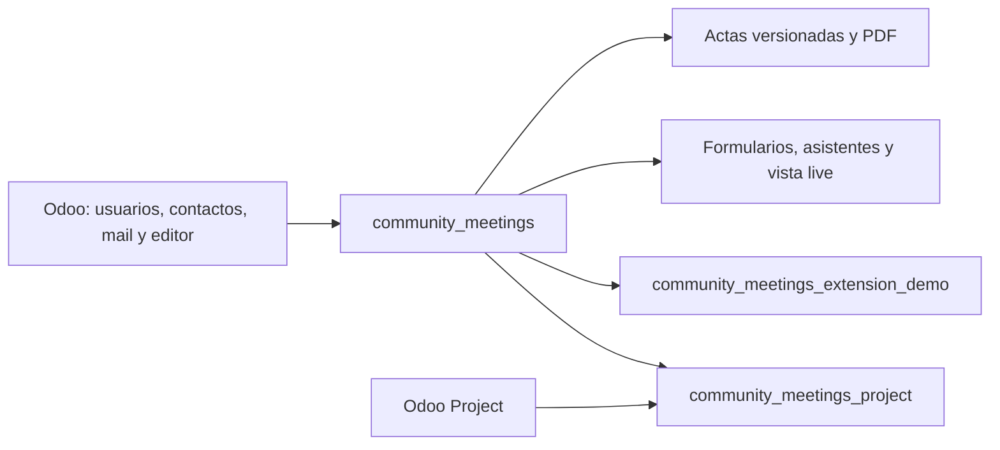
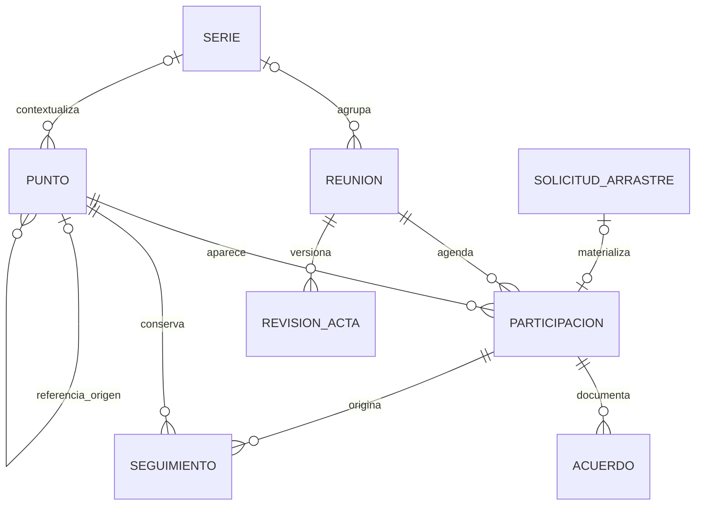
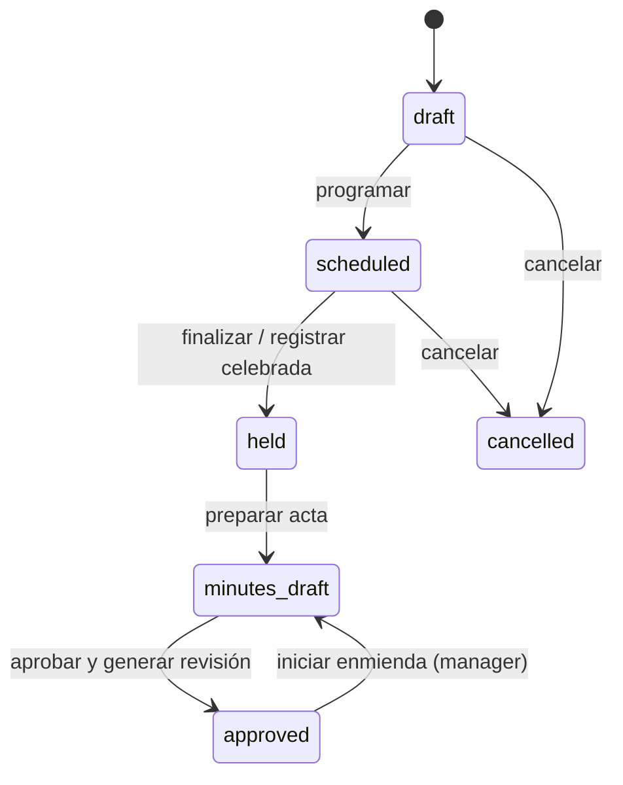
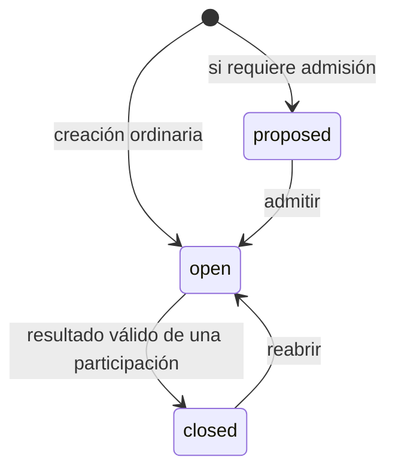
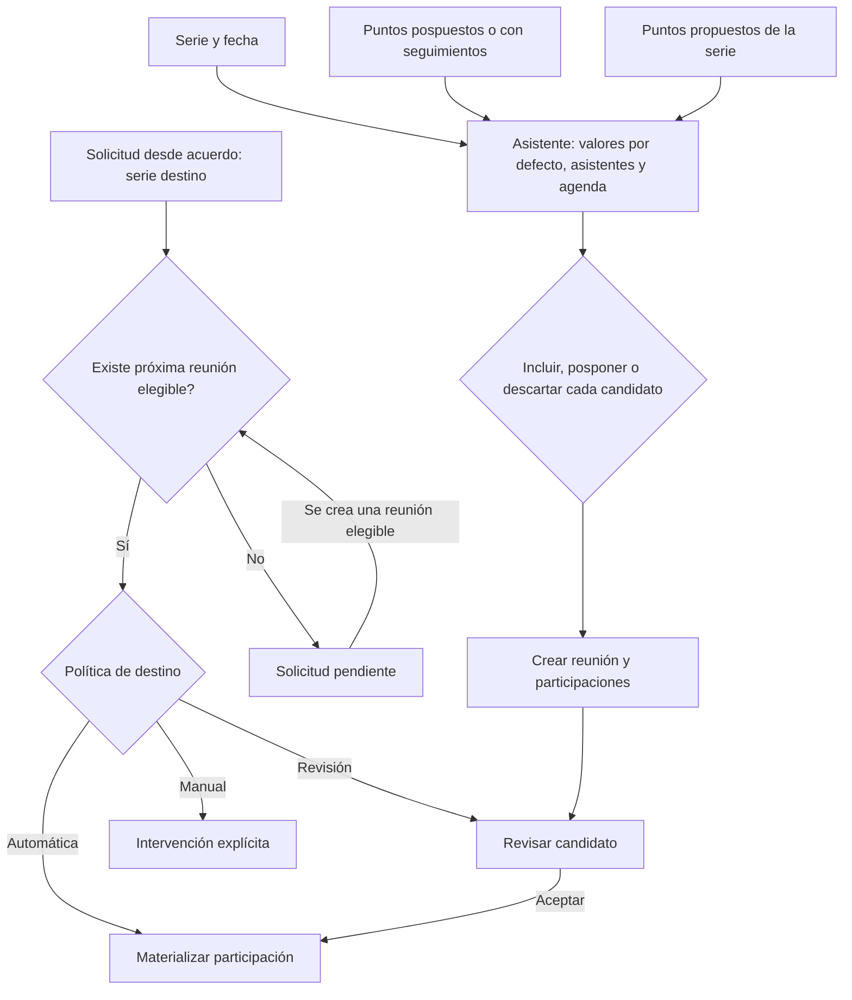
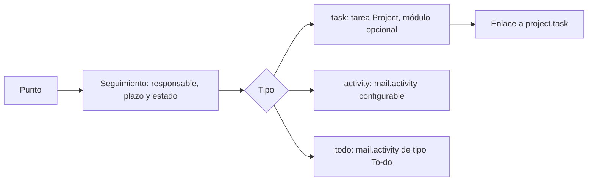

# Reuniones: modelo técnico y reglas de negocio

Modelo para Odoo 18. Describe lo implementado;
las divergencias y decisiones abiertas figuran en **Concerns**. Los diagramas son Mermaid.

## 1. Límites del sistema

Core gobierna reuniones, agenda, propuestas, decisiones, seguimientos y actas.
Project añade enlaces a tareas, selección/creación de proyectos y requisitos de
cierre adicionales. El módulo demo ejemplifica extensiones; no es un requisito
del negocio. Las extensiones usan herencia Odoo y hooks para preparar avisos,
validar aprobación, completar snapshots y preparar solicitudes de arrastre.

## 2. Entidades e identidad

| Concepto | Modelo `community.meeting…` | Responsabilidad |
|---|---|---|
| Serie | `.series` | Valores habituales: asistentes, duración, nombres, tipos y política de arrastre; puntos estructurales opcionales. |
| Reunión | modelo base | Sesión concreta, permisos, fechas estimadas/reales, organizador, secretario y estado del acta. Puede existir sin serie. |
| Punto | `.topic` | Identidad persistente del asunto, contenido, prioridad, plazo, estimación y estado global. |
| Participación | `.agenda.item` | Presencia del punto en una reunión: orden, contenido de sesión, notas, resultado, tiempos y revisión futura. |
| Tipo | `.agenda.type` | Nombre configurable con un comportamiento conocido por el código. |
| Acuerdo | `.resolution` | Texto y estado del acuerdo; puede determinar aprobación/rechazo de un punto decisorio. |
| Disenso / nota privada | `.dissent` / `.editor.note` | Disenso ligado a punto o acuerdo, con inclusión optativa en acta; notas editoriales privadas excluidas de publicación. |
| Seguimiento | `.action` | Trabajo asignado, plazo y progreso; conserva el enlace al punto y a la sesión de origen. |
| Propuesta | `.topic` con `state=proposed` | Punto de una serie aún no admitido; guarda autoría, respuesta y estado de revisión. No tiene participación hasta incluirse. |
| Arrastre | `.carryover` | Solicitud trazable desde punto, acuerdo o seguimiento hacia otra reunión; puede esperar una serie de destino. |
| Revisión | `.revision` | Evidencia aprobada: snapshot JSON, PDF, hashes, aprobador y versión anterior. |

**Punto ≠ participación.** Una propuesta ya es un punto, aunque todavía no
figure en ninguna reunión. Reutilizar un punto dentro de su serie conserva su
identidad y crea otra participación. Los cambios de contenido se propagan a
participaciones futuras aún no iniciadas; las sesiones pasadas conservan su
contenido. El seguimiento de un acuerdo hacia otra serie crea otro punto y
mantiene la trazabilidad a través de la solicitud de arrastre.

## 3. Ciclos de vida

La ejecución real es una dimensión adicional: una reunión `scheduled` puede
estar sin iniciar, en curso o pausada. Inicio, pausa y fin registran tiempos;
pausar no equivale a finalizar. La enmienda permite preparar una nueva revisión
sin reescribir la evidencia ya aprobada.

El punto tiene `state`, `outcome` y `postponed`. La participación tiene
`disposition` (`open`, `discussed`, `deferred`, `closed`) y, si es decisoria,
`decision_result` (`pending`, `approved`, `denied`). Son estados relacionados,
pero representan ámbitos distintos. Revisar un punto ya cerrado como follow-up
no debe modificar su resultado global.

| Comportamiento | Regla principal |
|---|---|
| Información | Marcar tratado cierra el asunto. |
| Discusión | Puede quedar tratado o cerrarse como resuelto. |
| Decisión | Para cerrar exige un acuerdo activo con resultado aprobado/rechazado coincidente. Sólo uno puede determinar el resultado. |
| TODO | Para cerrar exige seguimiento no cancelado y asignado; no exige que el trabajo esté terminado. Project puede exigir además tarea válida. |
| Aprobación de actas | Muestra actas anteriores pendientes de la serie; Review abre su live y la aprobación genera su revisión. |
| Próxima reunión | Recoge una fecha propuesta/elegida. |
| Follow-up | Permite tratar el seguimiento de otro asunto; no implica por sí mismo ejecutar una tarea. |

Comenzar un punto activa su cronómetro y pausa los demás. Pausar conserva el
tiempo acumulado; reanudar suma otro intervalo. En live, los registros se editan
con el punto en curso. La pausa de reunión o punto bloquea también los cambios
directos de notas y resultado en el servidor; las acciones de acuerdo y reapertura
aplican las transiciones válidas. Las notas pueden editarse al redactar el acta.
Posponer activa la revisión futura. Al finalizar, los puntos iniciados y sin
resolver quedan preparados para revisión posterior.

## 4. Preparación y continuidad

El arrastre requiere misma empresa, destino posterior y reunión destino en
borrador o programada. La serie destino del acuerdo prevalece sobre la de
origen; las solicitudes antiguas sin ese campo usan la serie de origen.
La materialización es idempotente: una solicitud no debe crear dos participaciones.
Los seguimientos completados también pueden justificar revisión en otra sesión.
Al finalizar una reunión, ciertos seguimientos abiertos de puntos cerrados se
promueven a nuevos puntos trazables.

Una propuesta es un `.topic` con `state=proposed` y
`proposal_status=submitted`. Puede pasar a **accepted**, **rejected** o
**withdrawn**; aceptar la candidatura crea su participación y abre el mismo
punto persistente. Posponerla no crea participación y conserva la candidatura;
descartarla la rechaza. La elegibilidad usa grupos autorizados y concesiones por
persona, empresa, serie y vigencia. Poder proponer no concede acceso general a
las reuniones. Los candidatos de arrastre también pueden incluirse, posponerse
o descartarse; los descartes quedan trazados por la solicitud de arrastre.

## 5. Seguimientos y Project

`todo` significa una actividad de tipo To-do; no es una entidad del módulo
`project_todo`. Core ofrece actividad, To-do o ambas opciones, con un tipo
predeterminado. La política se hereda de empresa a serie y puede sobrescribirse
en el punto persistente. Cada seguimiento crea el tipo elegido. La actividad se
vincula al registro `.action`, que conserva la trazabilidad; no se crea trabajo
paralelo independiente. Project añade su propio tipo sin generar actividades.
Se admiten varios responsables: una actividad por persona, o varios asignados a
la tarea Project. El progreso de cada actividad completada se conserva; el
seguimiento termina cuando todos han completado su parte. Borrar la última
actividad válida de un TODO cerrado se rechaza; completarla registra evidencia
durable antes de que Odoo retire la actividad nativa. El responsable lector puede
completar su actividad sin adquirir permisos editoriales.

Project resuelve configuración de empresa → serie: sin proyecto predeterminado,
proyecto común o proyecto por serie. Distingue el destino predeterminado, el
requisito para cerrar TODO y el ámbito de tareas seleccionables. Las condiciones
de cierre se conservan como snapshots para que una configuración posterior no
invalide silenciosamente un cierre histórico.

La serie de una reunión puede asignarse, cambiarse o retirarse mientras siga
en borrador o programada, sin ejecución live ni revisión aprobada. La serie
nueva debe estar activa y coincidir en empresa y tipo de reunión. Los puntos
exclusivos siguen la serie; un punto compartido con otra reunión impide un
cambio incompatible. La revisión aprobada y su PDF no se reescriben.

## 6. Integridad, publicación y acceso

- **Servidor como autoridad:** métodos de transición, restricciones ORM y SQL;
  las protecciones visuales no sustituyen ACL ni reglas de registro.
- **Concurrencia:** bloqueos de filas al actualizar resultados compartidos,
  cronómetros y arrastres; claves únicas para ciclos de arrastre, acuerdo
  decisorio activo y número de revisión. Se aprovechan los reintentos de Odoo.
- **Acta:** aprobar genera JSON saneado y PDF con hashes SHA-256. La publicación
  usa la revisión, no los registros operativos mutables. Un hash permite comprobar
  integridad; no constituye una firma digital ni un sellado temporal externo.
- **Privacidad:** notas editoriales fuera del snapshot; disensos publicados sólo
  si están marcados. Los accesos a puntos, reuniones y tareas siguen sus permisos.
- **Roles acumulables:** Editor implica Reader; Approver implica Reader;
  Manager implica Editor y Approver. Proposer es una capacidad separada.
  La empresa y el ámbito de reunión/serie limitan el acceso de cada rol.

## 7. Concerns y resolución

Los siete hallazgos originales se han abordado con el siguiente diseño. El
desglose de implementación y validación se mantiene en [PLAN_CONCERNS.md](PLAN_CONCERNS.md).

| Prioridad original | Hallazgo | Solución |
|---|---|---|
| Alta | Aprobador sin Editor no podía entrar en live. | Capacidades separadas de lectura, edición y aprobación; proyección pública del disenso; sin carga de notas privadas ni editores en modo lectura. |
| Media | La pausa sólo bloqueaba la UI. | Validación editorial en servidor y bloqueo común de reunión para guardados y cronómetros; redacción posterior y progreso operativo permitidos. |
| Media | El snapshot omitía la serie destino. | Esquema v2 con identificador/nombre de serie y representación en PDF; revisiones anteriores conservadas. |
| Media | Asistente y solicitudes seguían circuitos diferentes. | Servicio común de candidatos y materialización, revalidado al confirmar; excluir una reunión no descarta la solicitud. |
| Media | Puntos promovidos sin conexión con la próxima agenda. | Candidatos identificados por seguimiento original, con primera participación en el punto promovido y deduplicación. |
| Media | Dos significados de tarea. | Actividades/To-dos nativos configurables en core; task pertenece a Project; varios responsables con trazabilidad y evidencia de cierre. |
| Media | Fecha sin hora ni zona explícita. | Fecha y hora locales en live, zona por serie, UTC en almacenamiento; recurrencia local y rechazo de horas ambiguas/inexistentes. |

### Pendientes de comprobación

La validación completa de navegador, incluida la separación de core y Project,
está pendiente en el ticket local 48 del plan de ejecución.
Los resultados antiguos de Playwright y cobertura son evidencia fechada, no
validación de los cambios de este ciclo. La posible eliminación de registros
generales de reunión, los puntos recurrentes y el flujo de adjuntos siguen como
decisiones futuras independientes.

Fuentes principales: [modelo de reunión](../community_meetings/models/meeting.py),
[puntos y participaciones](../community_meetings/models/topic.py),
[reglas de agenda](../community_meetings/models/agenda_item.py),
[arrastre](../community_meetings/models/carryover.py),
[asistente](../community_meetings/models/creation_wizard.py),
[candidatos de agenda](../community_meetings/models/agenda_preparation.py),
[elegibilidad de propuestas](../community_meetings/models/proposal_eligibility.py),
[revisiones](../community_meetings/models/revision.py),
[actividades](../community_meetings/models/followup_activity.py),
[roles](../community_meetings/security/groups.xml),
[política Project](../community_meetings_project/models/project_policy.py).
