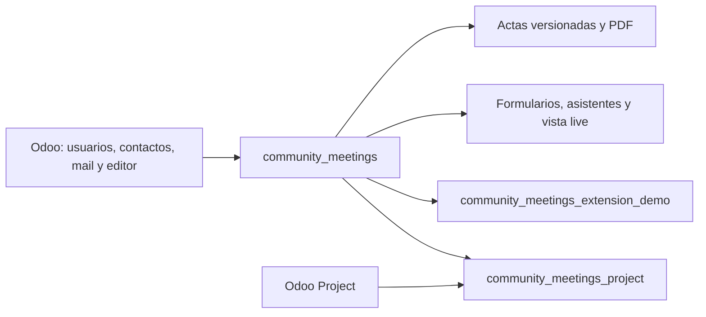
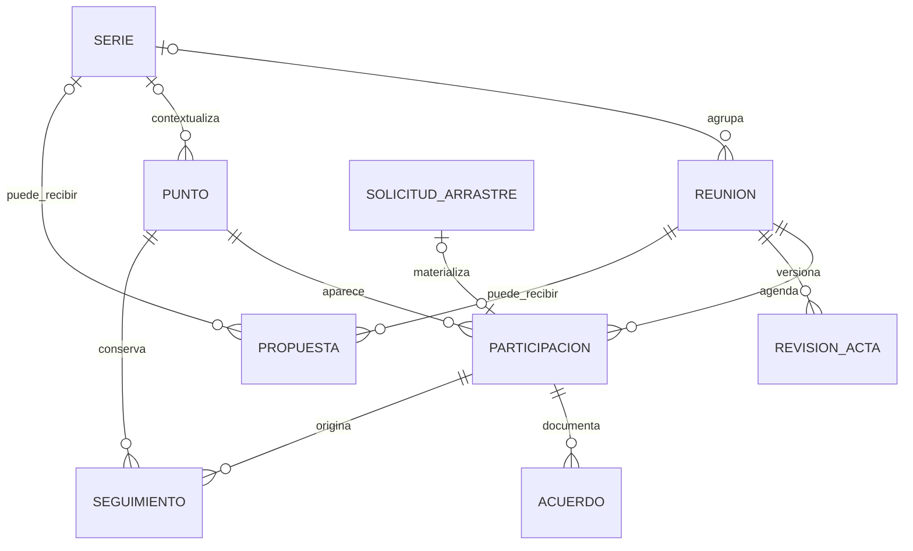
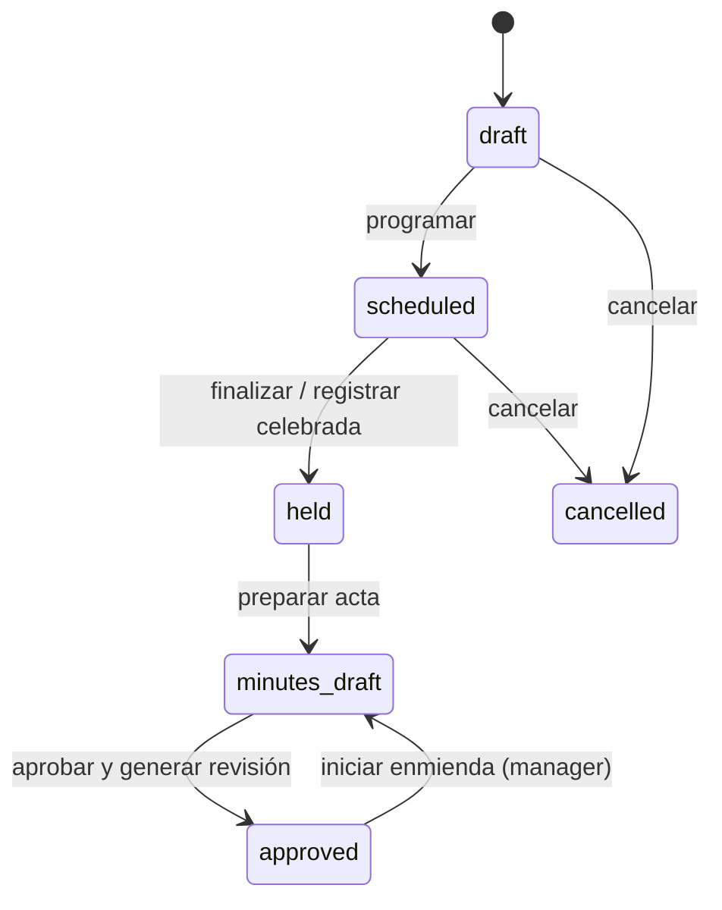
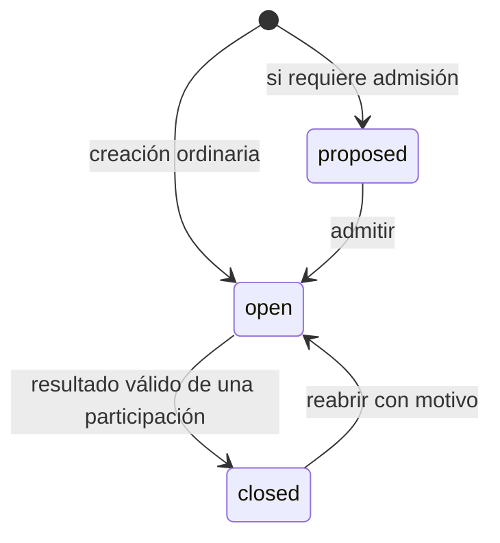
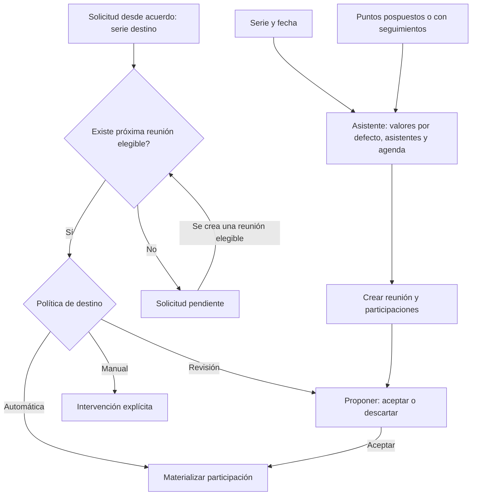
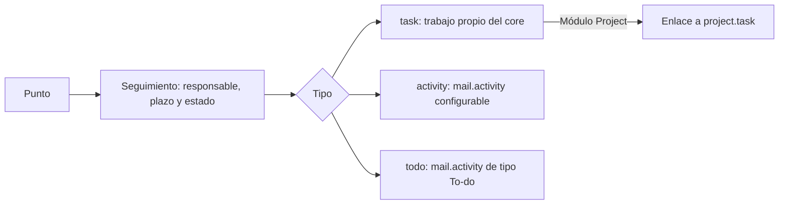

# Reuniones: modelo técnico y reglas de negocio

Estado contrastado con el código en `1f6f2b4` (Odoo 18). Describe lo implementado;
las divergencias y decisiones abiertas figuran en **Concerns**. Los diagramas son Mermaid.

## 1. Límites del sistema

Core gobierna reuniones, agenda, propuestas, decisiones, seguimientos y actas.
Project añade enlaces a tareas, selección/creación de proyectos y requisitos de
cierre adicionales. El módulo demo ejemplifica extensiones; no es un requisito
del negocio. Las extensiones usan herencia Odoo y hooks para preparar avisos,
validar aprobación, completar snapshots y preparar solicitudes de arrastre.

## 2. Entidades e identidad

| Concepto | Modelo `community.meeting…` | Responsabilidad |
|---|---|---|
| Serie | `.series` | Valores habituales: asistentes, duración, nombres, tipos y política de arrastre; puntos estructurales opcionales. |
| Reunión | modelo base | Sesión concreta, permisos, fechas estimadas/reales, organizador, secretario y estado del acta. Puede existir sin serie. |
| Punto | `.topic` | Identidad persistente del asunto, contenido, prioridad, plazo, estimación y estado global. |
| Participación | `.agenda.item` | Presencia del punto en una reunión: orden, contenido de sesión, notas, resultado, tiempos y revisión futura. |
| Tipo | `.agenda.type` | Nombre configurable con un comportamiento conocido por el código. |
| Acuerdo | `.resolution` | Texto y estado del acuerdo; puede determinar aprobación/rechazo de un punto decisorio. |
| Disenso / nota privada | `.dissent` / `.editor.note` | Disenso ligado a punto o acuerdo, con inclusión optativa en acta; notas editoriales privadas excluidas de publicación. |
| Seguimiento | `.action` | Trabajo asignado, plazo y progreso; conserva el enlace al punto y a la sesión de origen. |
| Propuesta | `.agenda.proposal` | Solicitud independiente de incorporación a agenda, sujeta a elegibilidad y revisión. |
| Arrastre | `.carryover` | Solicitud trazable desde punto, acuerdo o seguimiento hacia otra reunión; puede esperar una serie de destino. |
| Revisión | `.revision` | Evidencia aprobada: snapshot JSON, PDF, hashes, aprobador y versión anterior. |

**Punto ≠ participación.** Reutilizar un punto dentro de su serie conserva su
identidad y crea otra participación. Los cambios de contenido se propagan a
participaciones futuras aún no iniciadas; las sesiones pasadas conservan su
contenido. El seguimiento de un acuerdo hacia otra serie crea otro punto y
mantiene la trazabilidad a través de la solicitud de arrastre.

## 3. Ciclos de vida

La ejecución real es una dimensión adicional: una reunión `scheduled` puede
estar sin iniciar, en curso o pausada. Inicio, pausa y fin registran tiempos;
pausar no equivale a finalizar. La enmienda permite preparar una nueva revisión
sin reescribir la evidencia ya aprobada.

El punto tiene `state`, `outcome` y `postponed`. La participación tiene
`disposition` (`open`, `discussed`, `deferred`, `closed`) y, si es decisoria,
`decision_result` (`pending`, `approved`, `denied`). Son estados relacionados,
pero representan ámbitos distintos. Revisar un punto ya cerrado como follow-up
no debe modificar su resultado global.

| Comportamiento | Regla principal |
|---|---|
| Información | Marcar tratado cierra el asunto. |
| Discusión | Puede quedar tratado o cerrarse como resuelto. |
| Decisión | Para cerrar exige un acuerdo activo con resultado aprobado/rechazado coincidente. Sólo uno puede determinar el resultado. |
| TODO | Para cerrar exige seguimiento no cancelado y asignado; no exige que el trabajo esté terminado. Project puede exigir además tarea válida. |
| Aprobación de actas | Muestra actas anteriores pendientes de la serie; Review abre su live y la aprobación genera su revisión. |
| Próxima reunión | Recoge una fecha propuesta/elegida. |
| Follow-up | Permite tratar el seguimiento de otro asunto; no implica por sí mismo ejecutar una tarea. |

Comenzar un punto activa su cronómetro y pausa los demás. Pausar conserva el
tiempo acumulado; reanudar suma otro intervalo. En live, los registros se editan
con el punto en curso; las notas también pueden editarse al redactar el acta.
Posponer activa la revisión futura. Al finalizar, los puntos iniciados y sin
resolver quedan preparados para revisión posterior.

## 4. Preparación y continuidad

El arrastre requiere misma empresa, destino posterior y reunión destino en
borrador o programada. La serie destino del acuerdo prevalece sobre la de
origen; las solicitudes antiguas sin ese campo usan la serie de origen.
La materialización es idempotente: una solicitud no debe crear dos participaciones.
Los seguimientos completados también pueden justificar revisión en otra sesión.
Al finalizar una reunión, ciertos seguimientos abiertos de puntos cerrados se
promueven a nuevos puntos trazables.

Una propuesta tiene su propio circuito: **submitted → accepted / rejected / withdrawn**.
Aceptarla incorpora un punto a una reunión en borrador. Su autorización combina
grupos habilitados y concesiones por persona, empresa, serie y vigencia; poder
proponer no concede acceso general a las reuniones.

## 5. Seguimientos y Project

`todo` significa una actividad de tipo To-do; no es una entidad del módulo
`project_todo`. La actividad se vincula al registro `.action`, no directamente
a la reunión. El seguimiento conserva la trazabilidad cuando la actividad se
completa. El responsable actual es único.

Project resuelve configuración de empresa → serie: sin proyecto predeterminado,
proyecto común o proyecto por serie. Distingue el destino predeterminado, el
requisito para cerrar TODO y el ámbito de tareas seleccionables. Las condiciones
de cierre se conservan como snapshots para que una configuración posterior no
invalide silenciosamente un cierre histórico.

## 6. Integridad, publicación y acceso

- **Servidor como autoridad:** métodos de transición, restricciones ORM y SQL;
  las protecciones visuales no sustituyen ACL ni reglas de registro.
- **Concurrencia:** bloqueos de filas al actualizar resultados compartidos,
  cronómetros y arrastres; claves únicas para ciclos de arrastre, acuerdo
  decisorio activo y número de revisión. Se aprovechan los reintentos de Odoo.
- **Acta:** aprobar genera JSON saneado y PDF con hashes SHA-256. La publicación
  usa la revisión, no los registros operativos mutables. Un hash permite comprobar
  integridad; no constituye una firma digital ni un sellado temporal externo.
- **Privacidad:** notas editoriales fuera del snapshot; disensos publicados sólo
  si están marcados. Los accesos a puntos, reuniones y tareas siguen sus permisos.
- **Roles acumulables:** Editor implica Reader; Approver implica Reader;
  Manager implica Editor y Approver. Proposer es una capacidad separada.
  La empresa y el ámbito de reunión/serie limitan el acceso de cada rol.

## 7. Concerns

Hallazgos de lectura del código; no equivalen a una auditoría completa ni a
fallos reproducidos mediante nuevas pruebas en esta revisión.

| Prioridad | Hallazgo y consecuencia | Dirección recomendada |
|---|---|---|
| Alta | **Aprobador sin Editor no puede entrar en live.** Los grupos son independientes, pero `action_open_live_meeting` exige Editor. El circuito Review → aprobar no cubre a todos los aprobadores. | Permitir lectura live al aprobador autorizado y separar explícitamente edición de aprobación. |
| Media | **La pausa bloquea la UI, no todas las escrituras ORM de notas.** `write()` de la participación no exige cronómetro activo para `discussion_notes`. Otra vista o cliente puede editarlas durante una pausa. | Decidir si pausa es regla de integridad o sólo de interacción; si es regla, validarla en servidor preservando la edición posterior del acta. |
| Media | **El snapshot de arrastre no incluye la serie destino.** Si aún no existe reunión destino, la evidencia aprobada no conserva adónde se pidió enviar el acuerdo. | Incluir identificador y nombre de serie destino en el esquema del snapshot. |
| Media | **La selección del asistente y las solicitudes de acuerdos son circuitos distintos.** Las opciones iniciales se calculan desde participaciones; las solicitudes pendientes de acuerdos pueden aparecer sólo tras crear la reunión, para revisión en form/live. | Unificar la previsualización de candidatos y solicitudes antes de confirmar. |
| Media | **Promover un seguimiento no lo incorpora por sí solo a la próxima agenda.** `_promote_followups` crea un topic; `_carryover_candidates` busca participaciones existentes. No se observa una conexión automática entre ese nuevo topic y el selector de arrastre. | Incorporar los puntos promovidos a la preparación de agenda, con deduplicación respecto al seguimiento original. |
| Media | **Dos significados de “tarea”.** El core conserva `task` propio y crea actividades auxiliares para otros tipos; Project añade tareas enlazadas. No implementa todavía la simplificación solicitada de seguimiento nativo/múltiples responsables. | Resolver representación canónica y estrategia de migración antes de añadir más tipos. |
| Media | **Fecha de próxima reunión pierde precisión en live.** `setNextMeetingDate` recibe un input de fecha para un campo datetime. La hora/zona no tienen un flujo explícito. | Definir fecha frente a instante; añadir hora/zona o usar un campo Date coherente. |

Fuentes principales: [modelo de reunión](../community_meetings/models/meeting.py),
[puntos y participaciones](../community_meetings/models/topic.py),
[reglas de agenda](../community_meetings/models/agenda_item.py),
[arrastre](../community_meetings/models/carryover.py),
[asistente](../community_meetings/models/creation_wizard.py),
[revisiones](../community_meetings/models/revision.py),
[actividades](../community_meetings/models/followup_activity.py),
[roles](../community_meetings/security/groups.xml),
[política Project](../community_meetings_project/models/project_policy.py).
