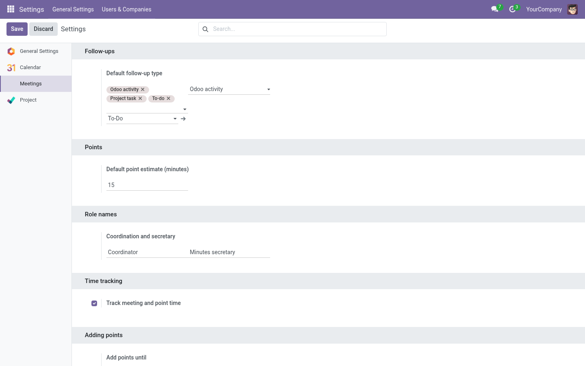

# General configuration (manager)

Everything in this page requires the **Manager** role and Odoo *Settings* access.
Location: **Settings → Meetings** (scroll inside the settings page).

The settings page has five blocks. All values are **company defaults**: any
series can override the point-level ones (see [Series](series.md)).

## Point estimate

| Setting | Meaning |
|---|---|
| **Default point estimate (minutes)** | Minutes pre-filled for new points that don't specify a duration. Used by the point wizard for standalone meetings and, through the series, everywhere else. |

*How resolution works:* a point's estimate is the value typed by the user, else
the **series** default, else this **company** default.

## Role names

| Setting | Meaning |
|---|---|
| **Coordination role name** | Label shown for the organizer role (e.g. "Organizer", "Presidenta"). |
| **Secretary role name** | Label shown for the minutes secretary role (e.g. "Secretaria de actas"). |

These are cosmetic: they let each organization speak its own language on forms
and reports.

## Time tracking

| Setting | Meaning |
|---|---|
| **Track meeting and point time** (on/off) | When **on** (default): the live meeting shows *Start / Pause / Resume meeting*, points have *Begin/Pause* timers, discussion notes are only editable while their point timer runs, and actual durations are recorded. When **off**: no timers at all — the live meeting is editable from the start and you simply *Finish* the meeting when done. |

> **Tip:** Turn time tracking off for organizations that find stopwatches stressful. The
> agenda workflow (agreements, dissents, follow-ups, minutes) works identically.

## Adding points

| Setting | Meaning |
|---|---|
| **Add points until** | The last moment when new points can be added to a meeting: |

| Value | Points can be added… |
|---|---|
| **Draft only** | Only while the meeting is a draft. |
| **Before it starts** | In draft, and once scheduled — until it actually starts. |
| **While it runs** *(default)* | In draft, scheduled and while the meeting is in progress. |

After that the **Add Point** buttons disappear and the server rejects attempts.
Series can override this per series (see [Series → Policies](series.md#policies)).

> **Note:** Points are never added to meetings whose minutes are already written
> (Held/Minutes draft/Approved) — record those as follow-ups or new proposals
> instead.

## Reordering agenda points

| Setting | Meaning |
|---|---|
| **Reorder agenda points until** | The last phase in which editors can change the order: **Draft only**, **Before it starts**, or **While it runs**. |

The policy uses the same phase boundaries as adding points. Reordering stops
when the meeting is marked **Held**, so the order used to prepare minutes stays
fixed. A series can override the company setting.

## Follow-ups

| Setting | Meaning |
|---|---|
| **Allowed follow-up types** | Which execution mechanisms points may use (Odoo activity, native To-do…). |
| **Default follow-up type** | Pre-selected when creating a follow-up. |
| **Default Odoo activity type** | Activity type used when a follow-up is an Odoo activity. |

For allowed types, an empty point or series selection inherits its parent. The
most specific configured choice applies: point, shared point, series, then
company. Project task types also require Project access.

With the **Project** addon installed, a *Project task policy* block appears
here too — see [Project integration](../integrations/project.md#task-policy).

## Where series fit

Every setting above that says "a series can override it" is edited on the
series form, tab **Policies** — read [Series configuration](series.md).

## Related catalogs

- [Meeting kinds and point types](catalogs.md#meeting-kinds)
- [Dissent reasons](catalogs.md#dissent-reasons)
- [Authorized proposer groups](catalogs.md#authorized-proposer-groups)
