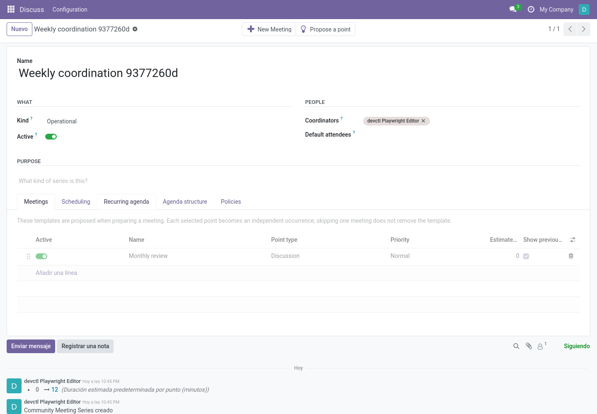
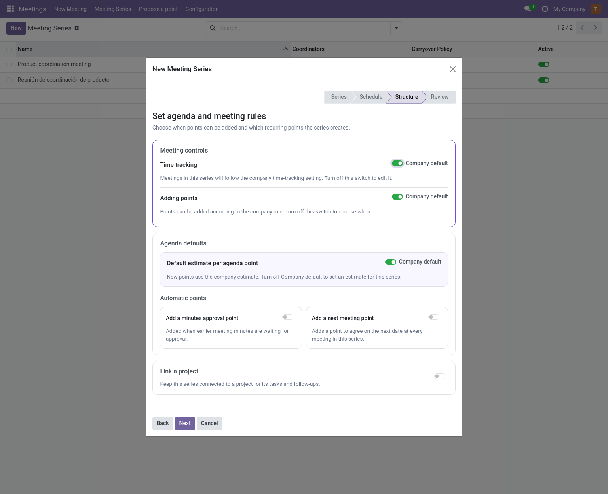
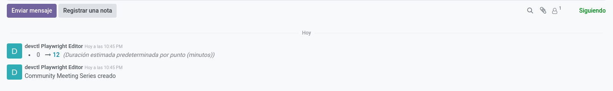

# Series configuration (manager / editor)

A **series** holds the defaults and rules for recurring meetings. New meetings
start from these choices; changing them later does not rewrite meetings already
created.

Location: **Meetings → Meeting Series**. The creation wizard (*New* in the
series list) has four steps: series identity and unfinished points, meeting
defaults, agenda and meeting rules, then review. **Usual attendees** are
suggested for each meeting and can be changed there. The agenda step explains
the time, point, and recurrence choices beside their controls.

In **Structure**, the company-default switches for time tracking, point policy
and point estimates start on. Turn a switch off to choose a series-specific
value. The **Automatic points** controls add a minutes-approval point to every
meeting and a next-meeting point to every meeting; both are optional and start
off. When minutes approval is enabled, approvers use that point for earlier
minutes and cannot approve those minutes directly. Enabling the next-meeting
point reveals the rule used to suggest its date.
With the Project addon, project linking is also optional and starts off.

## Chatter and change history

The series form includes a chatter. Changes to its settings are recorded there,
including changes to coordinators, usual attendees and allowed follow-up types.
With the Project addon, project destination and task policy changes are logged
there as well.

## Header: What and People

| Field | Meaning |
|---|---|
| **Kind** | Type of meetings this series holds (from the Meeting Kinds catalog). |
| **Company** | Owner company (multi-company only). |
| **Active** | Archived series keep their meetings but disappear from lists and menus. |
| **Coordinators** | Users responsible for preparing the meetings of this series. |
| **Default attendees** | People invited to every new meeting; still changeable per meeting. |

## Purpose

Free rich-text description, handy for newcomers. It is shown read-only on each
meeting as *Series description*.

## Scheduling

| Field | Meaning |
|---|---|
| **Default duration** | Planned length of each meeting. |
| **Timezone** | Used to propose the next meeting date unambiguously. |
| **New meeting name pattern** | E.g. `{date} {series}` → "2026-11-08 Community assembly". Tokens: `{date}`, `{series}`. |

## Agenda structure

| Field | Meaning |
|---|---|
| **Minutes approval point** | Adds a first agenda point to every meeting in the series. Only the assigned minutes secretary can approve earlier minutes. During a live meeting, the secretary also needs the Editor role and edit access; when preparing minutes for an offline meeting, they can approve there. **Review** opens a read-only preview and returns to this meeting. Direct approval on the earlier meeting is disabled. Reserve: 5 minutes per pending acta. |
| **Next meeting point** | Adds a last agenda point to set the next date. Reserves 5 minutes. |
| **Next meeting default** | Rule to pre-fill that date: *next weekday* (always Tuesday), *day of month*, or *after N days*. |

## Policies

This tab decides how the series behaves. Time tracking and adding-points rules
can use **Company default**; the unfinished-points rule is chosen explicitly.

### Unfinished points (carryover policy)

| Value | Behavior |
|---|---|
| **Review** *(default)* | Unfinished points are offered to the next meeting; an editor accepts or discards each one. |
| **Automatic** | Unfinished points continue into the next meeting without asking. |
| **Manual** | Nobody offers anything automatically; someone moves each point explicitly (*Move to another meeting*). |

### Time tracking

| Value | Behavior |
|---|---|
| **Company default** | Whatever Settings say. The effective company value is shown inline. |
| **On** | Timers and actual durations for this series' meetings. |
| **Off** | No start/pause timers: the live meeting is editable from the start; only the finish is recorded. |

### Adding points

| Value | Behavior |
|---|---|
| **Company default** | Follows *Settings → Adding points*. |
| **Draft only** | Points only while preparing the meeting. |
| **Before it starts** | Also once scheduled, until it begins. |
| **While it runs** | Also while the meeting is in progress, until it finishes. |

### Point estimates

| Field | Meaning |
|---|---|
| **Default point estimate (minutes)** | Pre-filled estimate for new points of this series. In the creation wizard, **Company default** is on initially; turn it off to set a series-specific estimate. A value of zero on the series form uses the company estimate. |

Minutes-approval and next-meeting structural points ignore this value: they
reserve 5 minutes each (5 per pending acta for approvals).

### Role names

Optional overrides of the coordination/secretary labels for this series only.

### Follow-ups

| Field | Meaning |
|---|---|
| **Allowed follow-up types** | Types new points of this series may use. |
| **Default follow-up type** | Pre-selected type. |
| **Default activity type** | For follow-ups recorded as Odoo activities. |

With the Project addon, the wizard's **Structure** step also lets you link the
new series to an existing project or create a project for it. A
**Follow-up and Task Policy** page is added to the series form — see
[Project](../integrations/project.md#task-policy).

### Recurring agenda templates

On **Recurring agenda**, editors can add templates, change their point type,
priority and estimate, reorder them, or deactivate them. Active templates are
proposed and selected by default when preparing each new meeting in the series.
An estimate of zero uses the series or company default. These settings affect
meetings created afterwards; they do not rewrite meetings that already exist.
Each template can also **Show previous discussion** in new occurrences. This is
on by default. Turn it off when a recurring point should start without the
earlier notes; the choice is saved on each occurrence, so later template edits
do not change meetings already prepared. Automatic *Minutes approval* and *Next
meeting* points do not use discussion history.

## Buttons and proposals

- **New Meeting** — opens the meeting creation wizard pre-loaded with this series.
- **Propose a point** — opens the proposal wizard targeted at this series.
- The **Proposals to review** alert (editors only) appears under the title when
  there are pending proposals, with Accept/Reject buttons — see
  [Propose a point](../user/propose-a-point.md).

## Meetings tab

Read-only list of this series' meetings, newest first, with state badges.
Open one to work on it.
