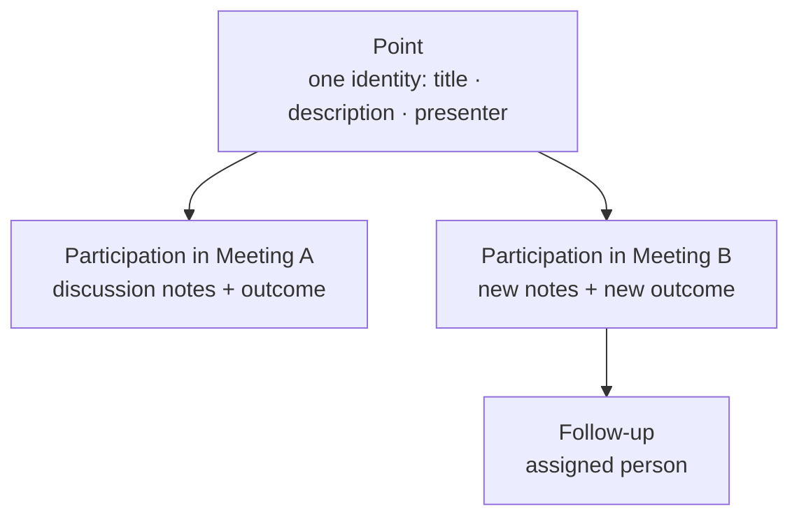

# Concepts and vocabulary

Everything in this guide uses the vocabulary below. Words are lowercase in the
interface but capitalized here when defined.

## Core objects

### Meeting
A concrete event with a date, duration, attendees and an agenda. It follows a
lifecycle (see [States](#meeting-states)). Each meeting belongs to one
**company** and, optionally, to one **series**.

### Series
A recurring meeting template: who coordinates it, its default attendees,
duration, timezone, naming pattern and — most importantly — its **policies**
(how points continue between meetings, whether time is tracked, when points can
be added, follow-up rules). Series *defaults are copied* into each new meeting:
changing the series later never rewrites existing meetings.

### Point
A subject with its own identity that can be treated across **several meetings**.
The point holds the durable information: title, description, presenter,
priority, deadline, links to other points. It keeps a state of its own
(`open`, discussed, closed, proposed…) that survives across meetings.

### Participation (agenda item)
One appearance of a point in one meeting. The participation stores what happened
*that day*: its discussion notes, its outcome (agreements, postponement…), the
time spent on it. When this guide says "a point in the agenda", it means a
participation.

### Agreement (resolution)
A documented decision produced in a meeting. On **decision** points the
agreement carries the *approved/rejected* result. Agreements have rich-text
bodies and can be withdrawn during the live meeting.

### Dissent and reservations
A recorded objection or reservation, with a reason catalog, the person
expressing it, and a flag to include it in the minutes or keep it internal.

### Follow-up
The durable record of "who has to do what": responsible people, deadline and an
execution mechanism — an Odoo **activity**, a native **To-do**, or (with the
Project addon) a **project task**. Follow-ups are born from points and keep
traceability to their origin.

### Minutes
The written record of the meeting. During the meeting the *live screen* feeds
them; when the meeting is **Held** they are formalized, and an **Approver**
freezes them into an immutable **revision** (with a PDF snapshot).

### Carryover
The act of including an already-existing point in a later meeting to continue
its treatment or to review a follow-up. Carryovers can be proposed
automatically by the series policy or requested manually.

## Meeting states

| State | Meaning |
|---|---|
| **Draft** | Being prepared. Points can be added (subject to the series policy). |
| **Scheduled** | Date confirmed. It appears on calendars and participants get context. |
| **In progress** *(display)* | The scheduled meeting has actually started. Not a separate stored state — the badge and the live screen reflect it. |
| **Held** | The meeting took place; time to write the formal minutes. |
| **Minutes draft** | Minutes are being written/adjusted before approval. |
| **Approved** | Minutes are frozen. Content becomes read-only; changes require a new **amendment** revision. |
| **Cancelled** | The meeting will not happen. |

> **Note:** With **time tracking off** (see [series policies](admin/series.md#policies)),
> there is no "Start Meeting" step: a scheduled meeting goes straight to
> **Finish**, and the live screen is editable from the beginning.

## Point outcomes

Each participation ends with one outcome:

| Outcome | Where it comes from |
|---|---|
| **Discussed** | Information/discussion points that were covered. |
| **Agreement (approved / rejected)** | Decision points with a recorded agreement. |
| **Postponed** | Not treated; optionally moved to another meeting (carryover). |
| **Closed (resolved)** | Discussion/TODO points that finished. |
| **Will be reviewed at the next meeting** | Explicit flag, typical for follow-ups. |

## Two special points

Series can automatically add two structural points to every meeting:

- **Minutes approval** (first item): lists previous meetings whose minutes are
  pending approval. Reserving 5 minutes per pending acta.
- **Next meeting** (last item): proposes the next date using the series rule
  (weekday, day of month, or every N days). Reserves 5 minutes.
