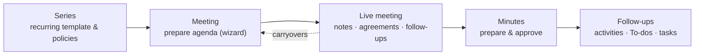

# Community Meetings — User & Administrator Guide

  

    
Prepare · meet · follow through

    <h2>Make every meeting easier to run — and easier to act on.</h2>
    
Keep the agenda, live discussion, decisions and next steps connected. Reuse points between meetings, record agreements as they happen, then review and approve a readable set of minutes.

    
<a class="guide-cta" href="user/prepare-meeting.md">Prepare your first meeting →</a>

  

  

  <article>
    
    <h3>Prepare with context</h3>
    
Build an agenda from a series or a one-off meeting. Bring forward open points and give attendees a clear plan.

    <a href="user/prepare-meeting.md">See how preparation works →</a>
  </article>
  <article>
    
    <h3>Keep the meeting moving</h3>
    
Work through one point at a time. Capture notes, agreements, follow-ups and postponed topics as the conversation unfolds.

    <a href="user/live-meeting.md">Explore the live meeting →</a>
  </article>
  <article>
    
    <h3>Leave with a reliable record</h3>
    
Review the draft, approve the minutes and carry actions into the next meeting. Approved revisions stay available as a record.

    <a href="user/minutes-and-approval.md">See minutes and approval →</a>
  </article>

Calendar and Project are optional: connect scheduled meetings to Odoo Calendar
and link follow-ups to Odoo Project tasks when those apps are part of your
workflow. See the [Calendar](integrations/calendar.md) and
[Project](integrations/project.md) guides.

## Who is who

The suite is role-based. Find your role, then follow its track:

| Role | Typical person | Start here |
|---|---|---|
| **Reader** | Any attendee who consults meetings and minutes | [Reading meetings](user/prepare-meeting.md#reading-a-meeting) |
| **Proposer** | Any internal user suggesting agenda points | [Propose a point](user/propose-a-point.md) |
| **Editor** | The person preparing and running meetings | [Prepare a meeting](user/prepare-meeting.md) |
| **Approver** | Whoever signs off the minutes | [Minutes and approval](user/minutes-and-approval.md) |
| **Manager** | The module administrator | [Administration](admin/configuration.md) |

Roles are cumulative: an Editor is also a Reader; a Manager is Editor + Approver.
See [Roles and permissions](roles-and-permissions.md).

## How the work flows

1. A **series** describes a recurring meeting (kind, people, schedule, policies).
2. Each concrete **meeting** is prepared from the series or standalone, with an
   **agenda** of **points**.
3. A **point** is a subject with its own identity: it can appear in several
   meetings, keeping a separate **discussion** and **outcome** in each one.
4. The meeting is **run live** from a dedicated screen: discussion notes,
   agreements, dissents, follow-ups and postponements are recorded in the
   moment.
5. When it finishes, the **minutes** are prepared and **approved**. Approval
   freezes an immutable **revision** with its PDF.

## Document map

| I want to… | Read |
|---|---|
| Understand the vocabulary | [Concepts](concepts.md) |
| Know who can do what | [Roles and permissions](roles-and-permissions.md) |
| Configure the modules | [General configuration](admin/configuration.md) · [Series](admin/series.md) · [Catalogs](admin/catalogs.md) |
| Prepare a meeting | [Prepare a meeting](user/prepare-meeting.md) |
| Suggest a point for a future meeting | [Propose a point](user/propose-a-point.md) |
| Run a meeting live | [Live meeting](user/live-meeting.md) |
| Write, approve or amend minutes | [Minutes and approval](user/minutes-and-approval.md) |
| Track who does what after the meeting | [Follow-ups](user/followups.md) |
| Move points to another meeting | [Carryovers](user/carryovers.md) |
| Use Calendar / Project | [Calendar](integrations/calendar.md) · [Project](integrations/project.md) |
| See what changed between releases | [Release notes](release-notes.md) |
| Solve a problem | [FAQ](faq.md) |
