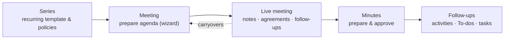

# Community Meetings — User & Administrator Guide

Welcome to the **Community Meetings** suite for Odoo 18. This guide teaches you
how to **use** and **administer** the modules — it does not cover installation.

### On this page

## What you get

| Module | What it does | For whom |
|---|---|---|
| **Community Meetings** (`community_meetings`) | Operational meetings with structured agendas, reusable points, resolutions, follow-ups, dissent, minutes and immutable approved revisions. | Everyone |
| **Community Meetings – Project Tasks** (`community_meetings_project`) | Links follow-ups to Odoo **Project** tasks and adds task policies. | Teams using Project |
| **Community Meetings – Calendar** (`community_meetings_calendar`) | Publishes each scheduled meeting as a read-only Odoo **Calendar** event. | Everyone with Calendar |
| **Extension Contract Demo** (`community_meetings_extension_demo`) | Synthetic example showing how developers extend meeting kinds. Developers only — ignore it in day-to-day use. | Developers |

## Who is who

The suite is role-based. Find your role, then follow its track:

| Role | Typical person | Start here |
|---|---|---|
| **Reader** | Any attendee who consults meetings and minutes | [Reading meetings](user/prepare-meeting.md#reading-a-meeting) |
| **Proposer** | Any internal user suggesting agenda points | [Propose a point](user/propose-a-point.md) |
| **Editor** | The person preparing and running meetings | [Prepare a meeting](user/prepare-meeting.md) |
| **Approver** | Whoever signs off the minutes | [Minutes and approval](user/minutes-and-approval.md) |
| **Manager** | The module administrator | [Administration](admin/configuration.md) |

Roles are cumulative: an Editor is also a Reader; a Manager is Editor + Approver.
See [Roles and permissions](roles-and-permissions.md).

## The 5-minute mental model

1. A **series** describes a recurring meeting (kind, people, schedule, policies).
2. Each concrete **meeting** is prepared from the series or standalone, with an
   **agenda** of **points**.
3. A **point** is a subject with its own identity: it can appear in several
   meetings, keeping a separate **discussion** and **outcome** in each one.
4. The meeting is **run live** from a dedicated screen: discussion notes,
   agreements, dissents, follow-ups and postponements are recorded in the
   moment.
5. When it finishes, the **minutes** are prepared and **approved**. Approval
   freezes an immutable **revision** with its PDF.

## Document map

| I want to… | Read |
|---|---|
| Understand the vocabulary | [Concepts](concepts.md) |
| Know who can do what | [Roles and permissions](roles-and-permissions.md) |
| Configure the modules | [General configuration](admin/configuration.md) · [Series](admin/series.md) · [Catalogs](admin/catalogs.md) |
| Prepare a meeting | [Prepare a meeting](user/prepare-meeting.md) |
| Suggest a point for a future meeting | [Propose a point](user/propose-a-point.md) |
| Run a meeting live | [Live meeting](user/live-meeting.md) |
| Write, approve or amend minutes | [Minutes and approval](user/minutes-and-approval.md) |
| Track who does what after the meeting | [Follow-ups](user/followups.md) |
| Move points to another meeting | [Carryovers](user/carryovers.md) |
| Use Calendar / Project | [Calendar](integrations/calendar.md) · [Project](integrations/project.md) |
| See what changed between releases | [Release notes](release-notes.md) |
| Solve a problem | [FAQ](faq.md) |
