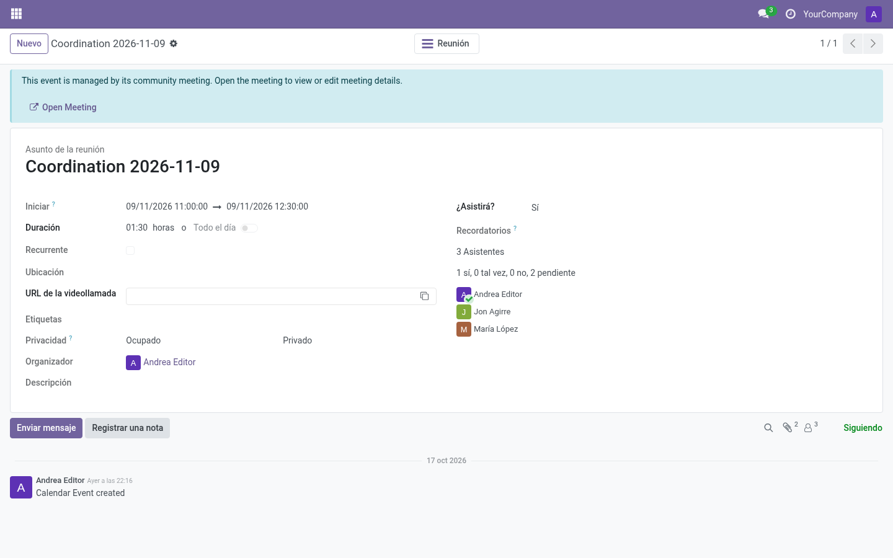

# Calendar integration (`community_meetings_calendar`)

Optional addon that mirrors scheduled meetings into Odoo's standard **Calendar**
so everyone sees them next to their other events.

## What it does

- **Scheduling** a meeting creates/updates a linked `calendar.event` with the
  same start, end, attendees, location and video call link.
- Changes to the meeting time, location and attendees update the linked event.
- Cancelling the meeting removes its linked Calendar event.

## What users can do

- See the meeting in their calendar (day/week/month views) and in reminders.
- Open the meeting from the event: the event shows an informational banner —
  *"This event is managed by its community meeting"* — and every meeting field
  becomes read-only there.

## What users cannot do

All meeting-managed fields are **read-only on the event**: name, dates,
duration, recurrency, attendees, alarms, privacy, description, categories and
the send/invitation buttons are disabled.

> **Note:** To change a meeting, always use the meeting (live screen or form) — never the
> calendar event. The event is a projection, not the source.

## FAQ

**Why can't I invite extra people from the event?** Attendees are managed on the
meeting (header → *Edit attendees*), which keeps the meeting as the single
source of truth.

**Do organizers still get Odoo reminders?** Yes — the event is a real calendar
event with normal alarms/notifications.
