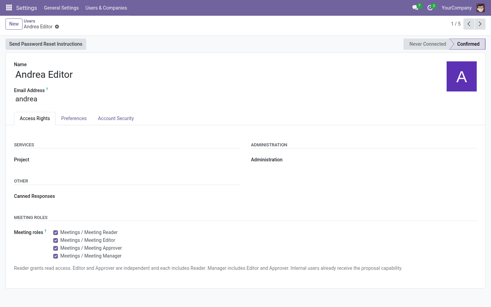

# Roles and permissions

Community Meetings is role-based. Roles are granted per user (by a system
administrator, on the user form → *Access Rights* → **Meeting roles**) and are
cumulative.

## The roles

| Role | What they can do |
|---|---|
| **Proposer** | Suggest new agenda points for a series (via *Propose a point*). Every internal user has this by default. |
| **Reader** | See the meetings they are organizer, secretary, or explicitly assigned reader of: agenda, discussion, agreements, minutes and approved PDFs. |
| **Editor** | Everything a Reader does, plus: prepare meetings, add/reorder points, run the live meeting, record agreements/dissents/follow-ups, postpone points, manage editorial notes, write minutes, request carryovers, manage series. |
| **Approver** | Everything a Reader does, plus: approve minutes. Independent from Editor. |
| **Manager** | Editor + Approver, plus: start amendments on approved meetings, assign per-meeting readers/editors, change a meeting's organizer, full configuration (catalogs, settings). |

> **Note:** Editor and Approver are independent: an approver who is not an editor can
> approve minutes but cannot modify the agenda. A manager includes both.

## Minutes approval routes

- Anyone with read access to the meeting can open its draft preview, including
  **Readers**. A user without access to the meeting cannot open the preview.
- Without a later-meeting minutes-approval point, a user needs the **Approver**
  role to approve minutes.
- When a series uses that point, only the meeting's assigned **minutes
  secretary** can approve earlier minutes from it. During a live meeting, that
  person also needs the **Editor** role and effective write access to the
  meeting. During offline preparation, the assigned secretary can approve
  without general editing rights.
- An Editor or Approver who is not the assigned minutes secretary cannot
  approve earlier minutes through the later-meeting point.

## Who sees a meeting

A meeting is visible to:

- its **organizer** (coordinator),
- its **minutes secretary**,
- the **readers** and **editors** explicitly assigned on the meeting's *Access*
  tab,
- any **manager** of the company.

Being listed as an *attendee contact* does **not** grant access — attendees are
contacts, not necessarily users. Grant user access on the **Access** tab.

## Restricted content

Two kinds of records are extra-restricted:

- **Editorial notes** — visible only to editors of the meeting. Never shown to
  readers and **never** included in approved minutes.
- **Dissents** — editors manage them; readers can read all recorded dissents,
  which form part of the minutes.

## Who can add points to a meeting?

Configured per company and per series (see
[Adding points](admin/configuration.md#adding-points)). Depending on the policy,
adding points stops when the meeting leaves draft, when it starts, or when it
finishes. The **Add Point** button simply disappears when not allowed.

## Proposals

Any internal user can propose points unless the manager restricts proposal to
specific groups (see [Authorized proposer groups](admin/catalogs.md#authorized-proposer-groups)).

## Quick reference matrix

| Action | Reader | Editor | Approver | Manager |
|---|:-:|:-:|:-:|:-:|
| See assigned meetings & minutes | ✔ | ✔ | ✔ | ✔ |
| Download approved PDF | ✔ | ✔ | ✔ | ✔ |
| Propose a point | ✔¹ | ✔ | ✔ | ✔ |
| Add points to an agenda | | ✔ | | ✔ |
| Run the live meeting | | ✔ | | ✔ |
| Record dissents / editorial notes | | ✔ | | ✔ |
| Write minutes | | ✔ | | ✔ |
| Approve minutes directly (without a later-meeting approval point) | | | ✔ | ✔ |
| Start an amendment | | | | ✔ |
| Assign per-meeting readers/editors | | ✔² | | ✔ |
| Configure series, kinds, settings | | | | ✔ |

¹ Or restricted to specific groups by configuration.

² Editors only on meetings they organize; managers on any meeting.
