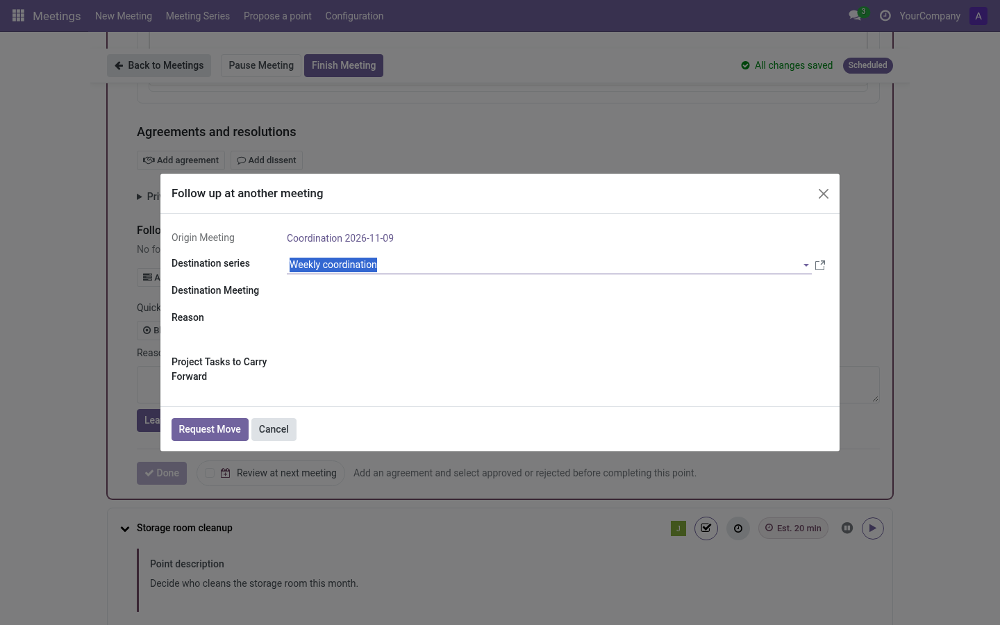

# Carryovers: moving points between meetings (editor)

A **carryover** continues the treatment of a point (or reviews a follow-up, or
moves an agreement) in a later meeting.

## The three ways a point moves

1. **Series policy — Review** *(default)*: when a meeting finishes, its
   unfinished points are offered to the next meeting of the series. Editors
   accept/discard during meeting creation and on the live screen (*Points to
   continue*).
2. **Series policy — Automatic**: same, without asking.
3. **Manual**: from any point, **Postpone → Move to another meeting** opens the
   carryover wizard, whichever the policy.

## The carryover wizard

- **Destination series** (mandatory for agreements/resolutions) or
  **destination meeting** (for points and follow-ups).
- **Reason** — free text; pre-filled with the postponement reason if any.
- With the Project addon: optionally carry **linked project tasks** (explicitly
  selected).

The destination meeting's editors receive it as *Points to continue* (policy
Review) or find it already in the agenda (policy Automatic). The record shows
origin meeting, context and who answered.

## Move it to another series

A point can outgrow its series (e.g. an operational point that needs a
reflective debate). The carryover wizard accepts a **destination series**:

- **Points and follow-ups** — pick the destination series, and optionally a
  concrete meeting of that series; leave the meeting empty and the point is
  offered at that series' next meeting.
- **Agreements (resolutions)** — the destination series is mandatory (they are
  treated at the series level).

The destination series can be any active series of the same company, so this is
the way to move a point out of its original scope.

## Accepting / dismissing

- **Accept** — the point joins the destination agenda as a new participation of
  the same point (identity preserved).
- **Dismiss** — the offer is rejected; under policy *Review* it may be offered
  again later, *Discard* in the creation wizard drops it permanently.

The continued point can show its earlier **discussion notes** as read-only
context, labelled with the source meeting. These notes stay on the original
participation and are not copied into the new meeting's minutes. An editor can
choose **Start without previous notes** to stop showing earlier discussion in
this continuation and later ones; the source notes remain intact. This control
does not apply to *Minutes approval* or *Next meeting* points.

To show that context again, restore the previous discussion on the point where
you hid it. Later continuations can then show the source notes again, provided
they have not independently hidden earlier discussion.

## Related docs

- [Series carryover policy](../admin/series.md#policies)
- [Creation wizard, continuing points](prepare-meeting.md#the-guided-wizard)
- [Project tasks inside carryovers](../integrations/project.md)
