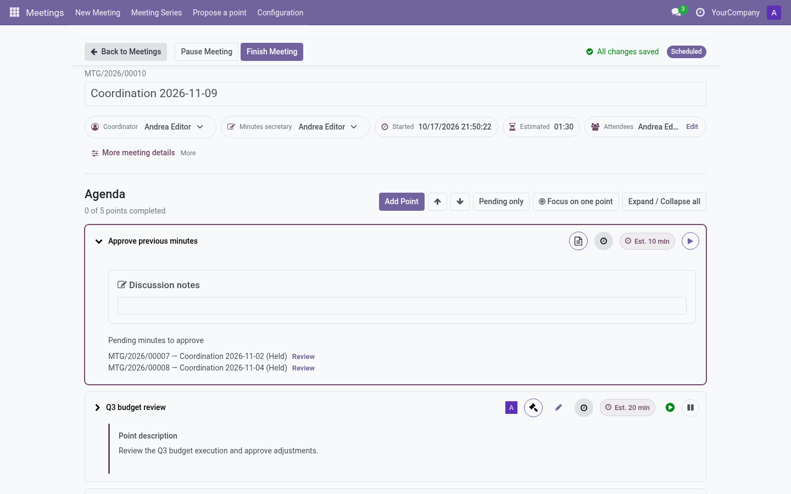
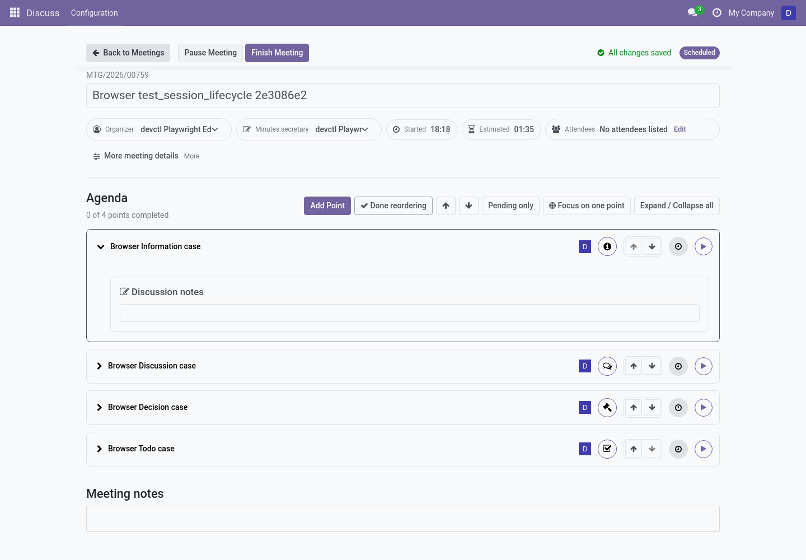
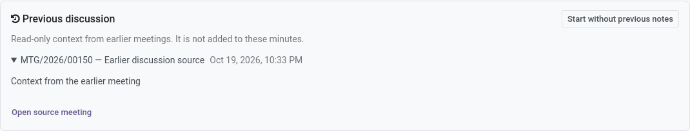

# The live meeting (editor)

The **live meeting** screen is a full-page workspace designed to be projected
during the meeting while taking notes at the same time. Open it from any
scheduled/held meeting: the ▶ button on the list or **Open Live Meeting** on
the form.

## Topbar

- **Back to Meetings** — safe exit (warns about unsaved edits).
- **Workflow buttons** — depend on state and policy:
  - *Start Meeting* / *Pause Meeting* / *Resume Meeting* — only with time
    tracking **on**. The setting is captured when the meeting starts, so
    changing company or series defaults does not strand a paused live meeting.
  - *Finish Meeting* — ends the meeting (with time tracking off it is available
    directly on a scheduled meeting; a confirmation dialog protects the
    retroactive *Record as Already Held* path).
  - *Prepare Minutes* — once held.
  - *Approve Minutes* — approvers, once minutes are drafted.
- **Save status** — *Saving… / All changes saved / Changes pending*: everything
  auto-saves as you type; the indicator tells you when it is safe to leave.
- **State badge** — current meeting state (Scheduled / In progress / …).

## Header

Name (inline editable), estimated vs **actual** start/end/duration (only with
time tracking on), coordinator and secretary (inline editable), location,
meeting link and attendees — with an *Edit attendees* search dialog.

## Points to continue

If this meeting inherits carried points (policy *Review*), an alert box lists
them with **Accept** / **Dismiss** before the agenda.

## Agenda cards

Each point is a card: title, presenter avatar, priority flag, type badge,
**outcome badge** and — with time tracking on — its timer controls
(*Begin/Pause point*, *Point in progress / paused*).

Tools above the list: **Add Point** (subject to the
[adding-points policy](../admin/configuration.md#adding-points)), previous/next
arrows, **Pending only** filter, **Expand/Collapse all**.

Regular agenda points can also be moved up or down when the series or company
reordering policy allows it. During a live meeting, choose **Reorder agenda**
above the cards to reveal the arrows; choose **Done reordering** when finished.
The minutes-approval, next-meeting, and individually fixed points keep their
positions. The order locks when the meeting is marked **Held**.

### Running a point

1. **Begin point** (time tracking on) — opens the point for editing and starts
   its timer; starting a new point pauses the previous one automatically.
2. **Discussion notes** — rich text, auto-saved. With timers on, notes are
   editable only while this point's timer is running (or after the meeting,
   while drafting minutes). Without timers, always editable until the meeting
   finishes.
   Earlier discussion, when available, appears above as read-only context and
   is never added to the current minutes. Editors can start without it; original
   notes remain on their source meetings.

3. **Record outcomes**:
   - *Information* — mark **Done**.
   - *Discussion* — **Done** when resolved, or **Postpone**.
   - *Decision* — record an **Agreement** with *approved/rejected* result; the
     point completes only with an agreement. Agreements can be withdrawn.
   - *TODO* — add an assigned **follow-up**; the point cannot be resolved
     without it (see [Follow-ups](followups.md)).
4. **Done** button completes the point; **Undo result** reopens it (asked
   reason optional).
5. **Postpone** — choose a quick reason (blocked by point/task/activity,
   lack of time, other…), an optional "blocked by" link, and either *Leave
   postponed* or *Move to another meeting* (carryover wizard). Postponed points
   are flagged **Review at next meeting** automatically.

### Records inside a point

- **Agreements** — the decisions (title, body, result). Withdraw an agreement
  to make the decision pending again.
- **Dissents** — author, reason catalog and statement. Every recorded dissent
  appears in the minutes.
- **Private editorial notes** — editor-only scratchpad, never in the minutes.
- **Follow-up tasks** — assigned owners, due dates, status, convert between
  kinds, *Several responsible people* under advanced options.
- **Related points / Origin / From follow-up** — links to jump across points.

### Special points

- **Next meeting** — a datetime field (series timezone shown) to set the next
  date.
- **Minutes approval** — lists previous actas pending approval with a *Review*
  shortcut, plus the history of already approved ones.

### Point options

*Point options → Edit point details* opens the full point record; **Reopen**
with a reason reverts a completed point.

## After the meeting

**Finish Meeting** closes the actual times, pauses open point timers, flags
unfinished points for review and promotes finished follow-ups into next-meeting
points. Then you are ready to write the minutes →
[Minutes and approval](minutes-and-approval.md).

Once a meeting has started, **Cancel** is no longer available: use **Finish
Meeting** to close its timers and preserve the actual session history.
