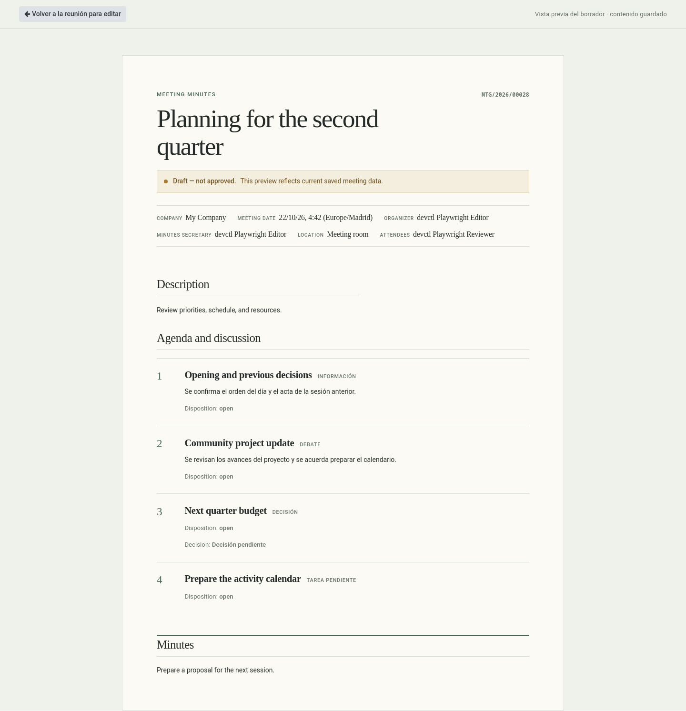
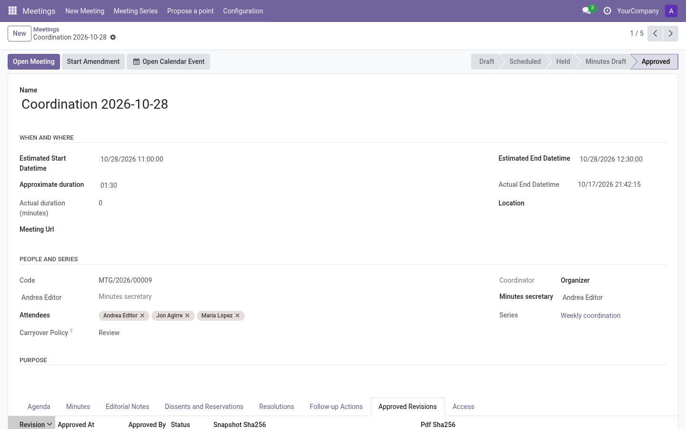

# Minutes and approval

The minutes are built from the live meeting work and formalized in two steps:
**prepare → approve**.

## 1. Prepare the minutes

When the meeting is **Held**, press *Prepare Minutes* (live screen) or on the
form. The meeting enters **Minutes draft**:

- The **Meeting notes** section (bottom of the live screen, or the *Minutes*
  tab on the form) becomes the focus. It is rich text, auto-saved.
- Discussion notes recorded per point stay on each point; the notes section is
  where the narrative acta lives.
- You can still add content, adjust agreements/dissents and fix follow-ups
  (with the [adding-points policy](../admin/configuration.md#adding-points)
  limiting brand-new agenda points).
- **Private editorial notes** are excluded from minutes — use them for internal
  remarks and delete them before approval if desired.

Before approval, use **Preview Minutes** from the meeting form or live screen to
review the complete draft assembled from the saved meeting data. The preview
marks the document as unapproved and points back to the meeting sections that
provide its content. Save pending live-screen edits first. Use **Meeting notes**
for the general narrative; agenda discussion, agreements, follow-ups and
included dissents are drawn from their own records. The official PDF is created
when an approver approves the minutes.

The preview shows the meeting time in your user timezone. Approved minutes use
the series timezone; standalone meetings use the company timezone, then UTC if
neither is set. The timezone is printed beside the time.

When the agenda includes a **Next Meeting** point, its agreed date and time are
included in the preview and frozen in the approved revision and PDF, using the
same minutes timezone. Later changes to the series schedule do not rewrite an
approved revision.

In **Held** or **Minutes draft** state, the preview is read-only: opening it and
choosing **Return to meeting to edit** leave the saved content and meeting state
unchanged. Anyone with read access to the meeting can open this preview; see
[Roles and permissions](../roles-and-permissions.md) for meeting access.

> **Tip:** The minutes-approval structural point of *later* meetings will list this acta
> until it is approved — approve promptly to keep the queue clean.

## 2. Approve

When the series requires a minutes-approval point, each pending earlier meeting
has its own **Approve earlier minutes** action on that point. Choose **Review**
beside an earlier meeting to open its saved draft in the read-only preview;
**Back to live meeting** returns to the same point. Reviewing does not pause or
finish an active agenda point. In offline preparation, the point closes after
all earlier minutes have been approved. Direct approval on the earlier meeting
is blocked for this series. Approval history links to the exact approved
revision, so a later amendment is recorded separately.

An earlier meeting still in **Held** state is marked **Preparation pending**;
prepare its minutes first. Only a meeting in **Minutes draft** can be approved
from the later meeting's point.

When a series does not use a later-meeting approval point, approve the minutes
with **Approve Minutes** (live screen or form header). When the point policy is
enabled, the current minutes stay pending for a later meeting's point; the
direct action is blocked. See [Roles and permissions](../roles-and-permissions.md)
for who can perform each approval route.

Approval:

- freezes the meeting into **Approved** state;
- creates an immutable **revision** with a content snapshot (SHA-256) and a
  rendered **PDF**;
- marks the acta as approved for the *minutes-approval points* of later meetings
  in the series;
- makes the meeting read-only for everyone.

## Approved revisions and amendments

The **Approved Revisions** tab lists each revision: number, approval date,
approver, status and a **PDF** button.

After approval, changing content is intentionally blocked. If something must be
corrected, a meeting manager presses **Start Amendment**: the meeting reopens for
editing under a new revision; the previous revision and its PDF remain
untouched in history.

## Dissents and the minutes

Every recorded dissent is part of the approved record. Private editorial notes
remain separate and are never included. Review recorded dissents with the editor
before approving.

## FAQs

**Who signs?** Whoever approves (recorded on the revision).

**Can I re-approve after an amendment?** Yes — the amendment is approved like
the original, producing revision N+1.

**Can a reader see an amended acta?** Readers always see the latest approved
content and can download each revision's PDF from the meeting if they had
access.
