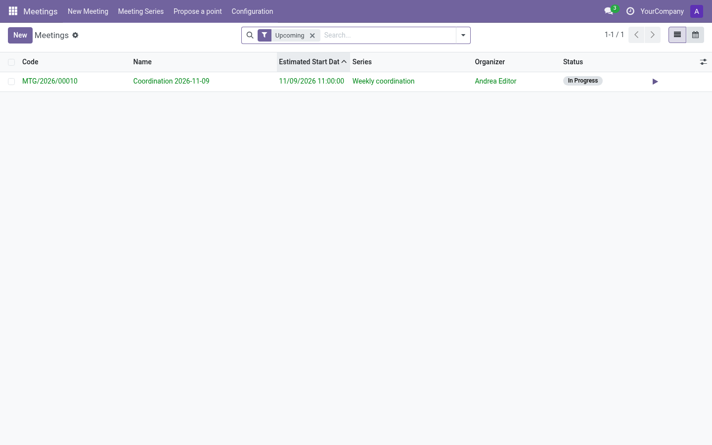
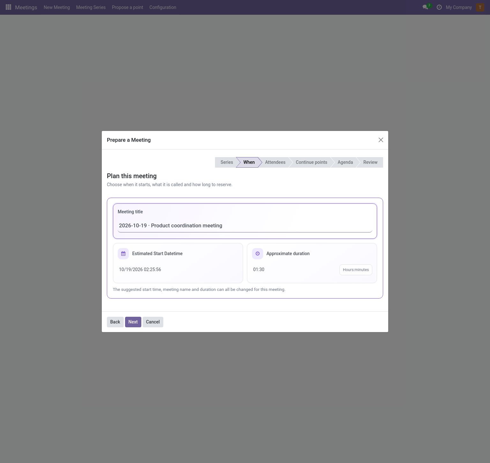
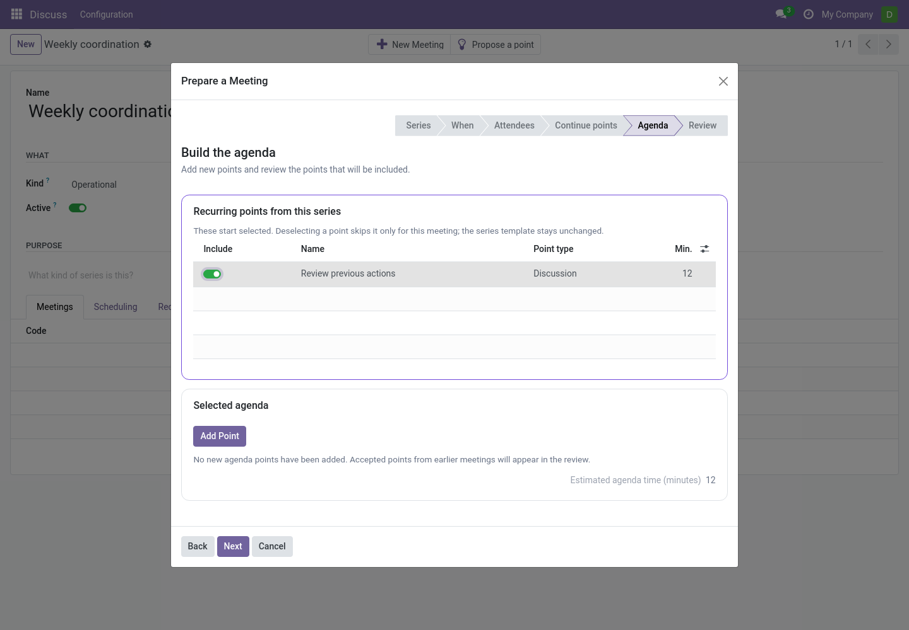
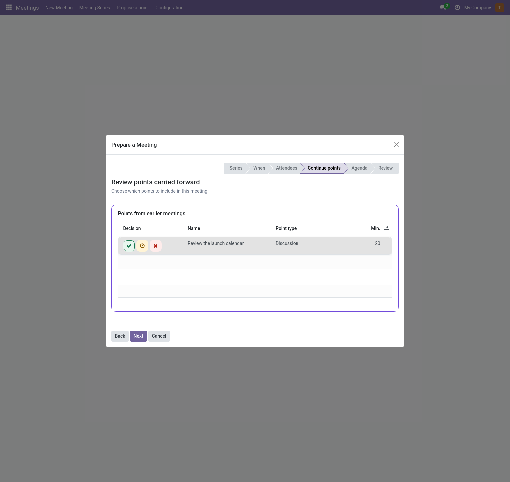
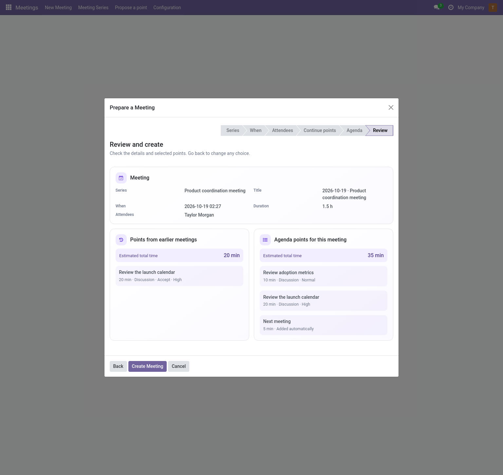
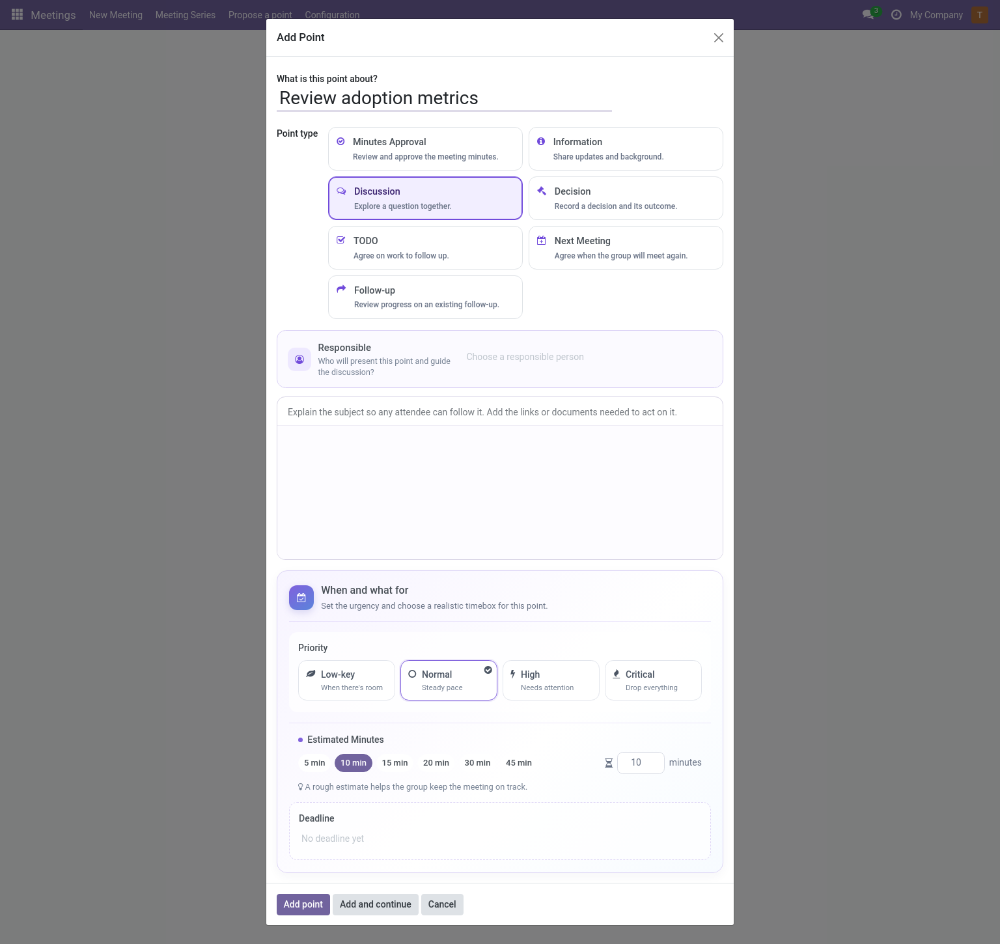

# Preparing a meeting (editor)

Two entry points: the **New Meeting** wizard (guided) or opening a series and
pressing **New Meeting** there (same wizard, series pre-selected).

## The guided wizard

The wizard walks six steps; *Back/Next* are free, and your edits are kept when
changing series. Series defaults are applied automatically when you choose a
series; there is no separate confirmation button.

1. **Series** — pick one, or leave empty for a standalone meeting. Choosing a
   series applies its suggestions automatically; changing series refreshes
   those suggestions while keeping your edits.
2. **When** — start date/time, title (pre-filled with the series pattern
   `{date} {series}`) and estimated duration. The date and clock icons mark the
   start and duration fields. Duration uses hours:minutes (`1:00` is one hour);
   the end time is derived.
3. **People** — attendees (pre-filled from the series).
4. **Continuing points** — if the series carryover policy is *Review*, points
   from previous meetings appear here with their origin and reason when
   available. Use the green check to **Accept** and include a point, the amber
   clock to **Postpone** it, or the red cross to **Discard** it permanently.
   Type, priority and estimated minutes are shown where available. If the
   policy is *Automatic*, unfinished points are already included.
5. **Agenda** — active recurring templates from the selected series start
   selected. Clear a template to skip it for this meeting; it remains on the
   series for later meetings. Each included template creates a separate point
   occurrence linked to its most recent earlier included occurrence, even if a
   meeting in between skipped it. Add other points now (or later). The
   selected-minutes estimate includes selected recurring points, points you add
   and continuing points you accepted. It does not yet include structural
   points the series may add automatically.
6. **Review** — check the meeting details and agenda. Continuing points show
   their title with decision and other metadata below it, plus a separate total
   estimate. The agenda summary includes automatic structural points when the
   series creates them; **Create Meeting** finishes.

> **Tip:** The wizard copies series defaults; it does not link to them. Changing the
> series afterwards does not rewrite the meeting.

The carryover step presents each earlier point with direct decision icons, and
the final review shows separate minute totals for carried points and this
meeting's agenda, including structural points added automatically.

If the agenda exceeds the planned duration, the review shows a warning with the
number of minutes over budget. This includes accepted points from earlier
meetings and automatic points. Go back to **When** to extend the duration, or
adjust the included points. The warning disappears once the agenda fits within
the planned time.

## Reading a meeting (reader track)

Readers open meetings from **Meetings → Meetings** (or the calendar). They see
the agenda with outcomes, discussion notes, published dissents, agreements,
follow-ups and — once approved — the minutes with a **PDF** download button on
the *Approved Revisions* tab. Everything is read-only.

## Adding points

On the meeting form, **Add Point** opens a focused dialog:

- **Title** — one clear line, this is what attendees read.
- **Point type** — selectable cards explain each type's live behavior. The
  selected type becomes compact; click it again to show the choices and
  explanations (see [catalogs](../admin/catalogs.md#agenda-point-types)).
- **Description** — rich text: context, links, documents.
- **Planning** — choose a priority (Low-key, Normal, High or Critical), use a
  minute preset or enter a custom estimate, and optionally set a deadline. The
  estimate is pre-filled from the series or company default.
- **Responsible** — choose near the top who will present the point. Related
  points can be linked below the planning fields.
- **More options** — click anywhere on this row to reuse an existing point or
  adjust its follow-up rules. Reusing a point keeps its title, description and
  type; you can change its responsible person here. Use **Clear selected
  point** to return to a new point.

Estimated minutes are pre-filled from the series, or from the company when the
series uses the company default.

The **Add and continue** button chains several points quickly.

> **Note:** Whether *Add Point* is available depends on the meeting state and the
> **adding-points policy** of its series — it disappears after the deadline and
> the server enforces it too.

On the meeting form, an **estimated agenda over budget** warning appears when
the sum of agenda estimates exceeds the meeting duration. Adjust the duration
or the agenda there.

## Scheduling and series changes

- **Schedule** confirms the meeting (requires a start date) and publishes the
  calendar event.
- The series can be changed while the meeting is *draft or scheduled* and live
  execution has not started. Points shared with other meetings constrain the
  move.
- **Cancel** is available in draft/scheduled.

## Access tab

Editors can grant **reader**/**editor** access on meetings they organize;
managers can also change the organizer, secretary and access of any meeting.

Next: run it live → [Live meeting](live-meeting.md).
