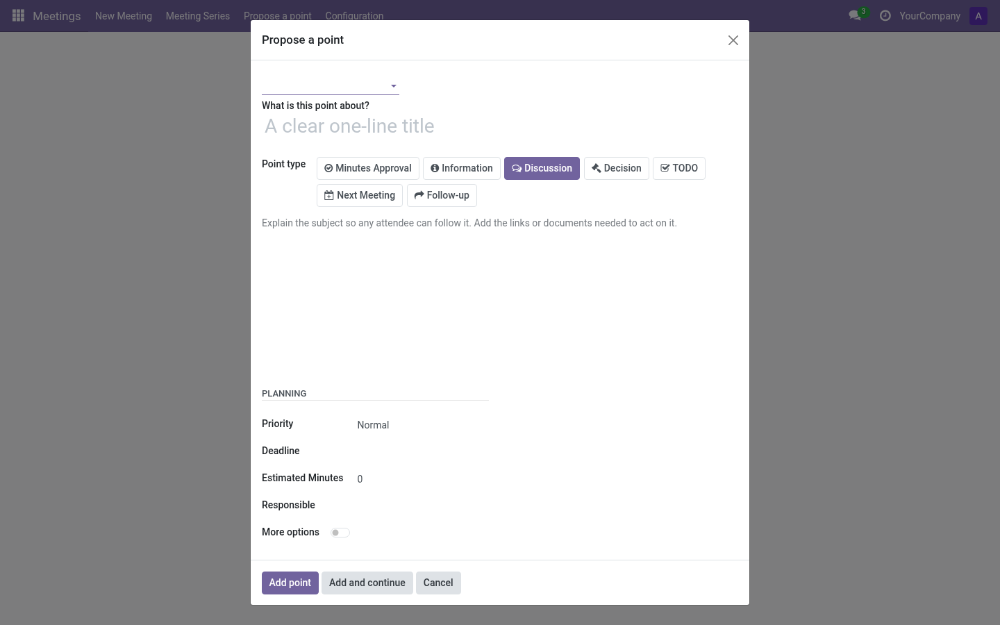
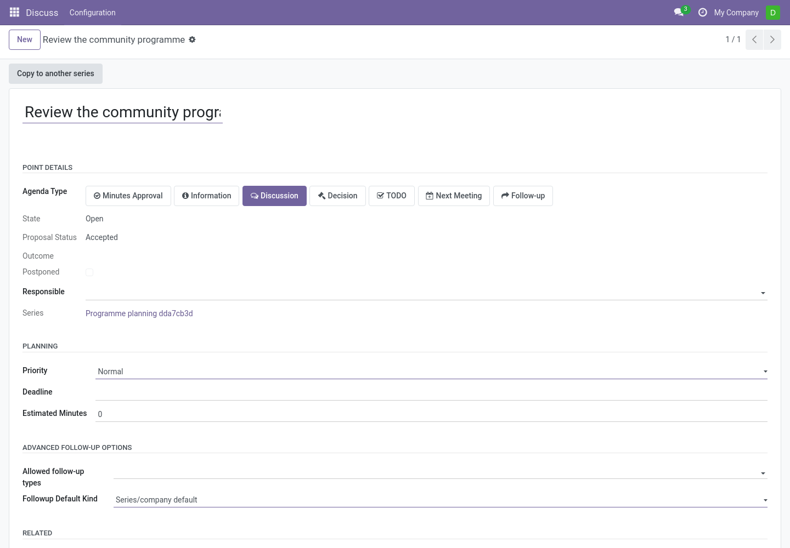

# Proposing a point (any internal user)

Anyone in the organization can suggest agenda points — editors decide what gets
in. Two entries:

- Menu **Meetings → Propose a point**: choose the target series.
- Series form → **Propose a point** button (series pre-selected).

## The proposal

1. **Series** — where the point should be treated (visible only when coming
   from the menu).
2. **Title** — one clear line: *What is this point about?*
3. **Point type** — information, discussion, decision, TODO…
4. **Description** — rich text: explain the subject so any attendee can follow
   it; add the links or documents needed to act on it.
5. **Planning** — choose a priority (Low-key, Normal, High or Critical), use a
   minute preset or enter a custom estimate, and optionally set a deadline.
   The estimate starts from the series or company default.
6. **Responsible** — the person presenting it (defaults to you). You can link
   related points in the main form.
7. **More options** — reuse an existing point and adjust its follow-up rules.

**Add point** submits. The proposal becomes a point in state *proposed*.

> **Note:** If your organization restricts proposals to specific groups and you are not a
> member, the wizard will refuse to save. See
> [Authorized proposer groups](../admin/catalogs.md#authorized-proposer-groups).

## What happens next

Editors see a **Proposals to review** alert on the series form (and in
preparation) listing pending proposals with **Accept** / **Reject**:

- **Accept** — the point becomes a regular point of the series and can be added
  to meetings.
- **Reject** — dismissed with a response; the proposer sees the decision in the
  point's chatter.

Proposers can follow their point's journey: accepted points show up in
meetings, each participation keeps its outcome, and approved minutes freeze it
for history.

## Reviewing proposals (editor)

The review list shows name, proposer and priority. Accept or reject one by one.
Rejection is visible in the point's history; nothing is deleted.

Acceptance requires an Editor or Manager who can edit the proposal, including
when using integrations. An Editor can review their own proposal. Acceptance
records the reviewer and response date; proposing alone does not grant access
to the destination meeting.

After upgrading, an older point may show **Admitted without recorded review**.
It remains available in its existing open or closed state. This label identifies
an earlier admission for which a completed review was not recorded; it does not
attribute a reviewer or response date retrospectively.
