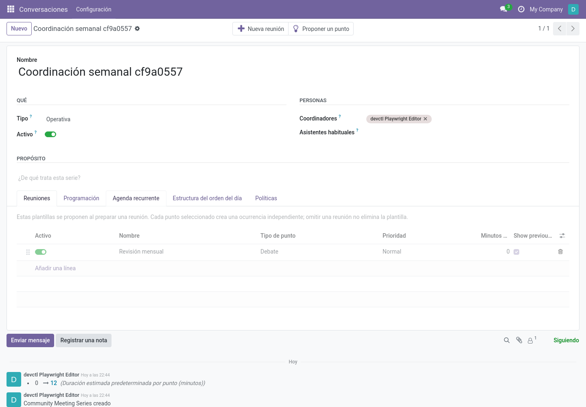
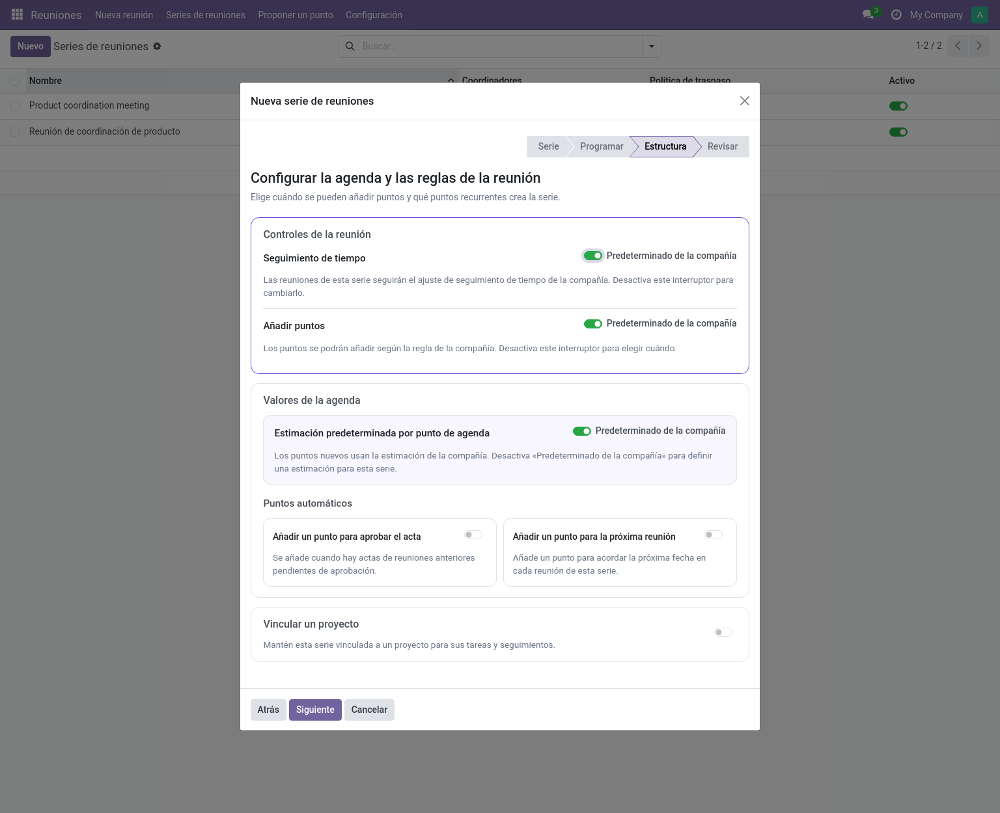

# Configuración de series (gestor / editor)

Una **serie** contiene los valores y reglas de las reuniones recurrentes. Las
reuniones nuevas parten de estas opciones; cambiarlas después no reescribe las
reuniones ya creadas.

Ubicación: **Reuniones → Series de reuniones**. El asistente de creación (*Nuevo* en la
lista de series) tiene cuatro pasos: identidad de la serie y puntos sin terminar,
valores de las reuniones, agenda y reglas, y revisión. **Asistentes habituales**
son las personas propuestas para cada reunión; podrás cambiarlas en cada caso.
El paso de agenda explica las opciones de tiempo, puntos y recurrencia junto a
sus controles.

En **Estructura**, los interruptores para usar los valores de la compañía en el
seguimiento de tiempo, la política de puntos y las estimaciones empiezan
activados. Desactiva uno para elegir un valor para la serie. **Puntos
automáticos** permite añadir un punto de aprobación del acta y un punto para
fijar la próxima reunión en cada reunión de la serie; ambos empiezan
desactivados. Al activar la aprobación, los aprobadores usan ese punto para las
actas anteriores y no pueden aprobarlas directamente. Al activar el punto de
próxima reunión aparece la regla para proponer la fecha. Con el módulo Project,
el vínculo con el proyecto también es opcional y empieza desactivado.

## Cabecera: Qué y Personas

| Campo | Significado |
|---|---|
| **Tipo** | Clase de reuniones que celebra esta serie (del catálogo Tipos de reunión). |
| **Compañía** | Compañía propietaria (solo multicompañía). |
| **Activo** | Las series archivadas conservan sus reuniones pero desaparecen de listas y menús. |
| **Coordinadores** | Usuarios responsables de preparar las reuniones de la serie. |
| **Asistentes habituales** | Personas invitadas a cada reunión nueva; siguen siendo modificables por reunión. |

## Propósito

Descripción en texto enriquecido, útil para quien llega nuevo. Se muestra en solo
lectura en cada reunión como *Descripción de la serie*.

## Programación

| Campo | Significado |
|---|---|
| **Duración prevista** | Duración planificada de cada reunión. |
| **Zona horaria** | Se usa para proponer la próxima fecha sin ambigüedad. |
| **Patrón de nombre** | P. ej. `{date} {series}` → "2026-11-08 Coordinación semanal". Tokens: `{date}`, `{series}`. |

## Estructura de la agenda

| Campo | Significado |
|---|---|
| **Punto de aprobación del acta** | Añade un primer punto a todas las reuniones de la serie. Los editores aprueban actas anteriores durante una reunión en vivo; si la reunión ocurrió offline, un aprobador puede hacerlo al preparar su acta. La aprobación directa en la reunión anterior queda desactivada. Reserva 5 minutos por acta pendiente. |
| **Punto de próxima reunión** | Añade un último punto para fijar la próxima fecha. Reserva 5 minutos. |
| **Regla de próxima reunión** | Regla para proponer esa fecha: *día de la semana* (siempre martes), *día del mes* o *cada N días*. |

## Políticas

Esta pestaña decide el comportamiento de la serie. El seguimiento del tiempo y
la política para añadir puntos pueden usar **Predeterminado de la compañía**;
la política de puntos sin terminar se elige expresamente.

### Puntos sin terminar (arrastre)

| Valor | Comportamiento |
|---|---|
| **Revisión** *(por defecto)* | Los puntos sin terminar se ofrecen a la siguiente reunión; un editor acepta o descarta cada uno. |
| **Automática** | Los puntos sin terminar continúan en la siguiente reunión sin preguntar. |
| **Manual** | Nadie ofrece nada automáticamente; alguien mueve cada punto explícitamente (*Mover a otra reunión*). |

### Seguimiento de tiempo

| Valor | Comportamiento |
|---|---|
| **Predeterminado de la compañía** | Lo que digan los Ajustes; el valor efectivo se muestra al lado. |
| **Activado** | Cronómetros y duraciones reales en las reuniones de esta serie. |
| **Desactivado** | Sin cronómetros: la reunión en vivo es editable desde el principio; solo se registra la finalización. |

### Añadir puntos

| Valor | Comportamiento |
|---|---|
| **Predeterminado de la compañía** | Sigue *Ajustes → Añadir puntos*. |
| **Solo borrador** | Los puntos solo se añaden preparando la reunión. |
| **Antes de empezar** | También programada, hasta que comience. |
| **Mientras se realiza** | También mientras está en curso, hasta que termine. |

### Estimaciones de puntos

| Campo | Significado |
|---|---|
| **Estimación predeterminada por punto (minutos)** | Estimación propuesta para los puntos nuevos de esta serie. En el asistente de creación, **Predeterminado de la compañía** está activado inicialmente; desactívalo para fijar un valor para la serie. Un valor cero en el formulario de la serie usa la estimación de la compañía. |

Los puntos estructurales (aprobación de acta y próxima reunión) ignoran este
valor: reservan 5 minutos cada uno (5 por acta pendiente en las aprobaciones).

### Nombres de rol

Sobrescrituras opcionales de las etiquetas de coordinación y secretaría solo para
esta serie.

### Seguimientos

| Campo | Significado |
|---|---|
| **Tipos de seguimiento permitidos** | Tipos que pueden usar los puntos nuevos de esta serie. |
| **Tipo de seguimiento por defecto** | Tipo preseleccionado. |
| **Tipo de actividad por defecto** | Para seguimientos registrados como actividades de Odoo. |

Con el módulo Project, el paso **Estructura** del asistente también permite
vincular la serie nueva a un proyecto existente o crear uno para ella. En el
formulario de la serie se añade la página **Política de seguimientos y tareas**;
ver [Project](../integrations/project.md#política-de-tareas).

### Plantillas de agenda recurrentes

En **Agenda recurrente**, los editores pueden añadir plantillas, cambiar su tipo
de punto, prioridad y estimación, reordenarlas o desactivarlas. Una estimación
de cero usa el valor predeterminado de la serie o la empresa. Las plantillas
activas se proponen y aparecen seleccionadas al preparar cada nueva reunión de
la serie. Estos ajustes afectan a las reuniones que se creen después; no
reescriben las reuniones existentes.

Cada plantilla permite activar **Mostrar debate anterior** en las nuevas
ocurrencias; viene activado. Desactívalo si ese punto recurrente debe empezar
sin las notas previas. La elección se guarda en cada ocurrencia y los cambios
posteriores de la plantilla no modifican reuniones ya preparadas. Los puntos
automáticos *Aprobación del acta* y *Próxima reunión* no muestran historial de
debate.

## Botones y propuestas

- **Nueva reunión** — abre el asistente de creación de reuniones con esta serie
  preseleccionada.
- **Proponer un punto** — abre el asistente de propuestas dirigido a esta serie.
- El aviso **Propuestas por revisar** (solo editores) aparece bajo el título cuando
  hay propuestas pendientes, con botones Aceptar/Rechazar — ver
  [Proponer un punto](../user/propose-a-point.md).

## Pestaña Reuniones

Lista de solo lectura con las reuniones de la serie, de más reciente a más
antigua, con insignias de estado. Abre una para trabajar con ella.
