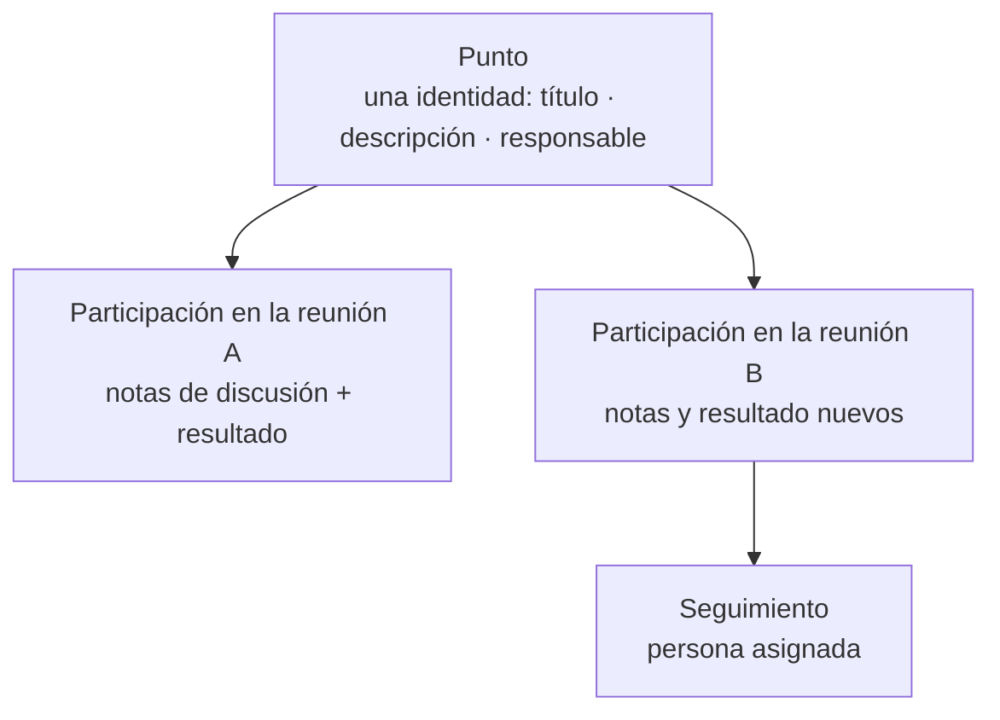

# Conceptos y vocabulario

Toda la guía usa el vocabulario siguiente. Las palabras se muestran en minúsculas
en la interfaz, pero aquí se definen en cursiva.

## Objetos básicos

### Reunión
Un evento concreto con fecha, duración, asistentes y orden del día. Sigue un
ciclo de vida (ver [Estados](#estados-de-la-reunión)). Cada reunión pertenece a
una **compañía** y, opcionalmente, a una **serie**.

### Serie
Plantilla de reunión recurrente: quién coordina, asistentes habituales,
duración, zona horaria, patrón de nombre y — sobre todo — sus **políticas**
(cómo continúan los puntos, si se registra el tiempo, cuándo se pueden añadir
puntos, reglas de seguimiento). Los valores de la serie **se copian** en cada
reunión nueva: cambiar la serie después nunca reescribe las reuniones existentes.

### Punto
Un asunto con identidad propia que puede tratarse en **varias reuniones**. El
punto guarda la información durable: título, descripción, ponente, prioridad,
plazo, vínculos con otros puntos. Mantiene su propio estado (`abierto`,
tratado, cerrado, propuesto…) que sobrevive entre reuniones.

### Participación (punto del orden del día)
Una aparición de un punto en una reunión concreta. La participación guarda lo
que ocurrió *aquel día*: sus notas de discusión, su resultado, el tiempo dedicado.
Cuando esta guía dice "un punto en la agenda" se refiere a una participación.

### Acuerdo
Una decisión documentada producida en una reunión. En los puntos **decisorios**
el acuerdo lleva el resultado *aprobado/rechazado*. Los acuerdos tienen cuerpo
en texto enriquecido y pueden retirarse durante la reunión en vivo.

### Discrepancias y reservas
Una objeción o reserva registrada, con un motivo del catálogo, la persona que la
expresa y una marca para incluirla en el acta o mantenerla interna.

### Seguimiento
El registro durable de "quién tiene que hacer qué": responsables, plazo y un
mecanismo de ejecución — una **actividad** de Odoo, un **TODO** nativo o (con el
módulo Project) una **tarea de proyecto**. Los seguimientos nacen de puntos y
conservan la trazabilidad con su origen.

### Acta
El registro escrito de la reunión. Durante la reunión la construye la *pantalla
en vivo*; al pasar la reunión a **Celebrada** se formaliza, y un **aprobador**
la congela en una **revisión** inmutable (con PDF).

### Arrastre
Incluir un punto ya existente en una reunión posterior para continuar su
tratamiento o revisar su seguimiento. Los arrastres pueden proponerse
automáticamente por la política de la serie o solicitarse manualmente.

## Estados de la reunión

| Estado | Significado |
|---|---|
| **Borrador** | En preparación. Se pueden añadir puntos (según la política de la serie). |
| **Programada** | Fecha confirmada. Aparece en calendarios. |
| **En curso** *(visual)* | La reunión programada ha comenzado de verdad. No es un estado almacenado: la insignia y la pantalla en vivo lo reflejan. |
| **Celebrada** | La reunión tuvo lugar; toca redactar el acta formal. |
| **Acta en borrador** | El acta se está escribiendo/ajustando antes de aprobar. |
| **Aprobada** | El acta está congelada. El contenido pasa a solo lectura; cambiarlo exige una nueva **revisión** por enmienda. |
| **Cancelada** | La reunión no se celebrará. |

> **Nota:** con el **seguimiento de tiempo desactivado** (ver
> [políticas de serie](admin/series.md#políticas)) no hay paso "Iniciar reunión":
> una reunión programada va directa a **Finalizar**, y la pantalla en vivo es
> editable desde el principio.

## Resultados de un punto

Cada participación termina con un resultado:

| Resultado | Origen |
|---|---|
| **Tratado** | Puntos informativos/de discusión cubiertos. |
| **Acuerdo (aprobado / rechazado)** | Puntos decisorios con acuerdo registrado. |
| **Pospuesto** | No tratado; opcionalmente movido a otra reunión (arrastre). |
| **Cerrado (resuelto)** | Puntos de discusión/TODO finalizados. |
| **Se revisará en la próxima reunión** | Marca explícita, típica de seguimientos. |

## Dos puntos especiales

Las series pueden añadir automáticamente dos puntos estructurales a cada reunión:

- **Aprobación del acta** (primer punto): lista las reuniones anteriores con el
  acta pendiente de aprobar. Reserva 5 minutos por acta pendiente.
- **Próxima reunión** (último punto): propone la siguiente fecha con la regla de
  la serie (día de la semana, día del mes o cada N días). Reserva 5 minutos.
