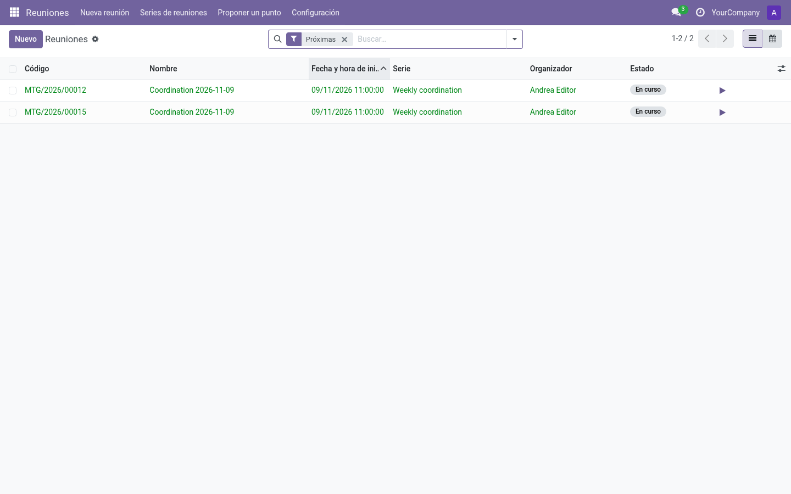
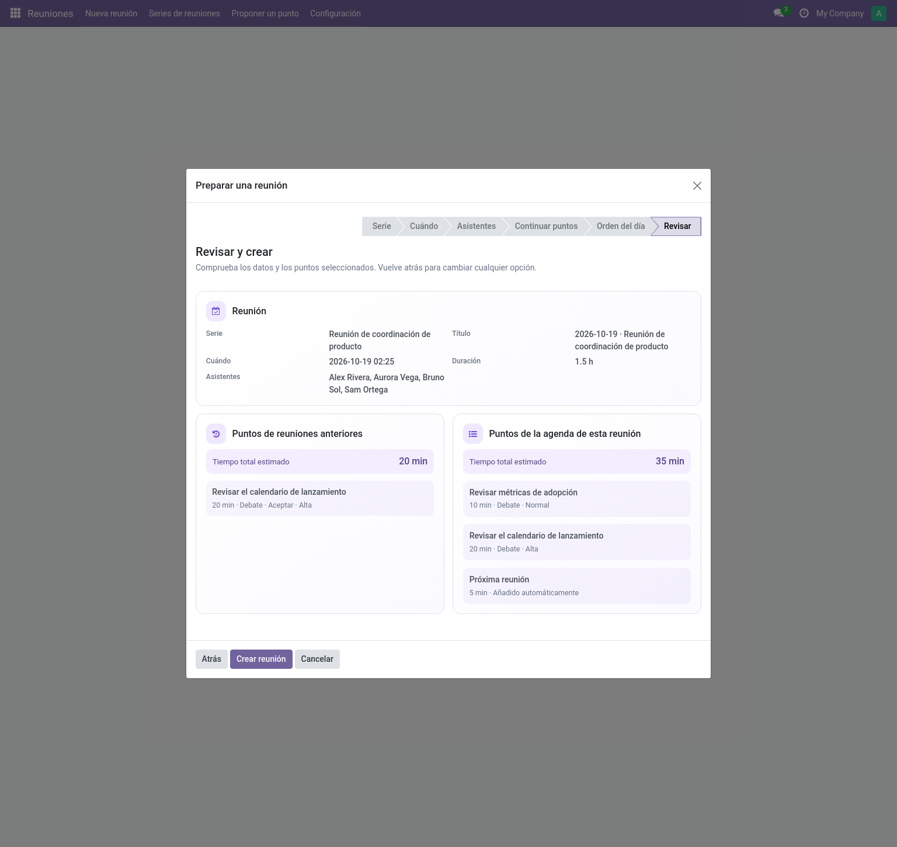
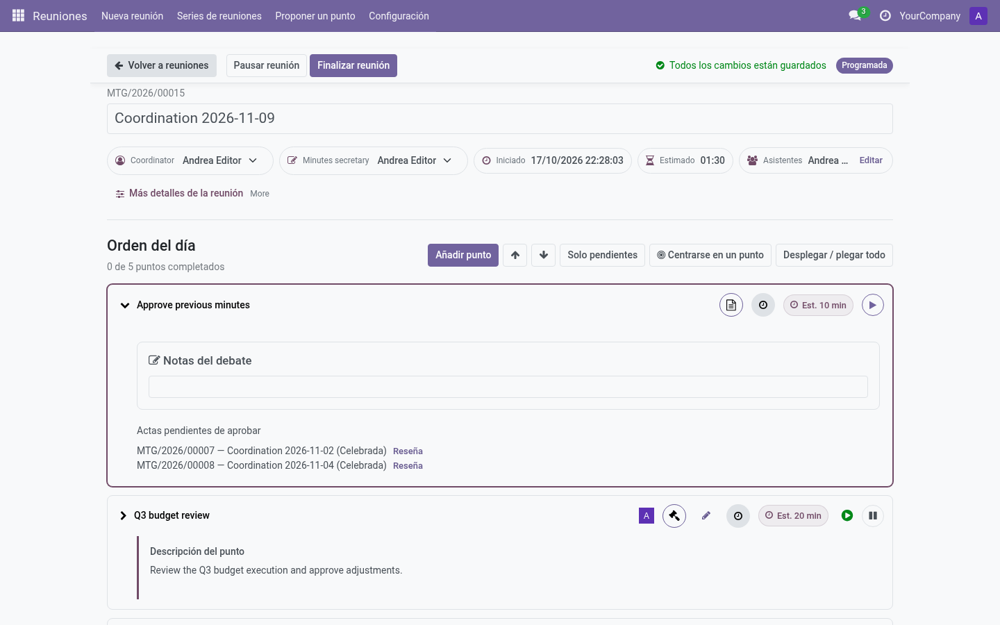
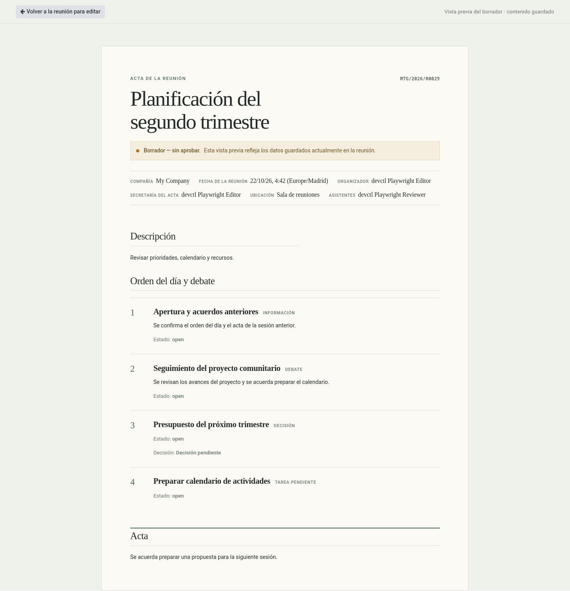

# Community Meetings — Guía de uso y administración

  

    
Preparación · reunión en vivo · seguimiento

    <h2>Reuniones más fáciles de llevar, con acuerdos y seguimientos claros.</h2>
    
Mantén conectados el orden del día, la conversación, las decisiones y los siguientes pasos. Reutiliza puntos entre reuniones, registra los acuerdos al tomarlos y revisa y aprueba un acta clara.

    
<a class="guide-cta" href="user/prepare-meeting.md">Prepara tu primera reunión →</a>

  

  

  <article>
    
    <h3>Prepara la reunión con contexto</h3>
    
Organiza el orden del día desde una serie o para una reunión puntual. Recupera los puntos abiertos y comparte un plan claro con las personas convocadas.

    <a href="user/prepare-meeting.md">Cómo preparar una reunión →</a>
  </article>
  <article>
    
    <h3>Mantén el ritmo de la reunión</h3>
    
Trabaja un punto cada vez. Anota la conversación, los acuerdos y seguimientos, y aplaza lo que necesite más tiempo.

    <a href="user/live-meeting.md">Descubre la reunión en vivo →</a>
  </article>
  <article>
    
    <h3>Cierra con un acta útil</h3>
    
Revisa el borrador, aprueba el acta y retoma las tareas en la siguiente reunión. Las revisiones aprobadas quedan como registro.

    <a href="user/minutes-and-approval.md">Actas y aprobación →</a>
  </article>

<aside class="integration-note">
  <strong>Conexiones opcionales.</strong> Si utilizas Odoo Calendar o Project, puedes vincular las reuniones programadas con eventos del calendario y los seguimientos con tareas. Consulta las guías de <a href="integrations/calendar.md">Calendario</a> y <a href="integrations/project.md">Project</a>.
</aside>

<section class="guide-section" id="roles">
  

    
Empieza por tu papel

    

      <h2>Encuentra tu lugar en la reunión</h2>
      
Elige el trabajo que haces y empieza por el paso que te resulte útil.

    

  

  

    <a class="role-row" href="user/prepare-meeting.md#leer-una-reunion">
      01<strong>Lector</strong><small>Consulta agendas, vistas previas de borradores y actas aprobadas.</small>Abrir una reunión →
    </a>
    <a class="role-row" href="user/propose-a-point.md">
      02<strong>Proponente</strong><small>Sugiere un asunto para un próximo orden del día.</small>Proponer un punto →
    </a>
    <a class="role-row" href="user/prepare-meeting.md">
      03<strong>Editor</strong><small>Prepara el orden del día y guía la reunión en vivo.</small>Preparar una reunión →
    </a>
    <a class="role-row" href="user/minutes-and-approval.md">
      04<strong>Aprobador</strong><small>Revisa y aprueba el acta de la reunión.</small>Revisar el acta →
    </a>
    <a class="role-row" href="admin/configuration.md">
      05<strong>Gestor</strong><small>Configura el módulo para la organización.</small>Configurar reuniones →
    </a>
  

  
<strong>Los roles se acumulan.</strong> Los Editores también pueden leer; el rol Gestor incluye Editor y Aprobador. Consulta <a href="roles-and-permissions.md">roles y permisos</a>.

</section>

<section class="guide-section journey-section" id="flujo-reunion">
  

    
Un registro conectado

    

      <h2>Un mismo hilo, desde la preparación hasta el seguimiento</h2>
      
La serie sirve de base para las reuniones recurrentes. Cada reunión conserva su agenda y su propio registro; los puntos abiertos pueden retomarse más adelante.

    

  

  

    

      

        <article class="workflow-source">
          Reuniones recurrentes
          <strong>Serie</strong>
          
Asistentes habituales, plantillas de agenda y reglas de reunión.

        </article>
        <article class="workflow-source standalone">
          Una sola reunión
          <strong>Puntual</strong>
          
Prepárala sin crear una serie.

        </article>
      

      →
      <article class="workflow-meeting-card">
        

          Se prepara la reunión
          <strong>Fecha · personas · orden del día</strong>
        

        

          Orden del día
          
<b>01</b>Punto para esta reunión

          
<b>02</b>Punto abierto que se retoma

        

      </article>
    

    <ol class="workflow-stages">
      <li>01Durante la reunión<strong>Trabaja cada punto</strong>
Guarda las notas, los acuerdos y los seguimientos junto a cada punto.
</li>
      <li>02Al terminar<strong>Prepara el acta</strong>
Reúne las notas de la reunión y los resultados de los puntos en un borrador legible.
</li>
      <li>03Aprobación<strong>Deja un registro oficial</strong>
La aprobación guarda una revisión inmutable y su PDF.
</li>
      <li>04Siguientes pasos<strong>Continúa el trabajo</strong>
Asigna tareas y decide qué puntos abiertos necesitan otra reunión.
</li>
    </ol>

    

      

        Entre reuniones
        <strong>El punto puede continuar; cada reunión conserva su propio registro.</strong>
      

      

        <article class="workflow-occurrence">
          Reunión 1
          <strong>Punto compartido</strong>
          
Discusión y resultado de esta reunión

        </article>
        
Se retoma<b>→</b>

        <article class="workflow-occurrence">
          Reunión 2
          <strong>El mismo punto</strong>
          
Nueva discusión y resultado

        </article>
      

    

  

</section>

<section class="guide-section guide-library" id="indice-guia">
  

    
Para volver cuando lo necesites

    

      <h2>Ve directamente a la guía que buscas</h2>
      
Primero los pasos prácticos; después, la configuración y las referencias.

    

  

  

    <section>
      <h3>Preparar y participar</h3>
      <ul>
        <li><a href="user/prepare-meeting.md">Preparar una reunión</a></li>
        <li><a href="user/propose-a-point.md">Proponer un punto</a></li>
        <li><a href="user/live-meeting.md">Llevar la reunión en vivo</a></li>
        <li><a href="user/minutes-and-approval.md">Revisar y aprobar el acta</a></li>
        <li><a href="user/followups.md">Registrar seguimientos</a></li>
        <li><a href="user/carryovers.md">Retomar un punto</a></li>
      </ul>
    </section>
    <section>
      <h3>Configurar las reuniones</h3>
      <ul>
        <li><a href="roles-and-permissions.md">Roles y permisos</a></li>
        <li><a href="admin/configuration.md">Configuración general</a></li>
        <li><a href="admin/series.md">Series de reuniones</a></li>
        <li><a href="admin/catalogs.md">Catálogos de puntos y acuerdos</a></li>
      </ul>
    </section>
    <section>
      <h3>Consultar referencias</h3>
      <ul>
        <li><a href="concepts.md">Conceptos y vocabulario</a></li>
        <li><a href="integrations/calendar.md">Integración con Calendario</a></li>
        <li><a href="integrations/project.md">Integración con Project</a></li>
        <li><a href="release-notes.md">Notas de versión</a></li>
        <li><a href="faq.md">Preguntas frecuentes</a></li>
      </ul>
    </section>
  

</section>
