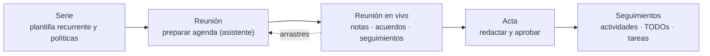

# Community Meetings — Guía de uso y administración

  

    
Preparación · reunión en vivo · seguimiento

    <h2>Reuniones más fáciles de llevar y con acuerdos que se cumplen.</h2>
    
Mantén conectados el orden del día, la conversación, las decisiones y los siguientes pasos. Reutiliza puntos entre reuniones, registra los acuerdos al tomarlos y revisa y aprueba un acta clara.

    
<a class="guide-cta" href="user/prepare-meeting.md">Prepara tu primera reunión →</a>

  

  

  <article>
    
    <h3>Prepara la reunión con contexto</h3>
    
Organiza el orden del día desde una serie o para una reunión puntual. Recupera los puntos abiertos y comparte un plan claro con las personas convocadas.

    <a href="user/prepare-meeting.md">Cómo preparar una reunión →</a>
  </article>
  <article>
    
    <h3>Mantened el ritmo de la reunión</h3>
    
Tratad un punto cada vez. Anotad la conversación, los acuerdos y seguimientos, y aplazad lo que necesite más tiempo.

    <a href="user/live-meeting.md">Descubre la reunión en vivo →</a>
  </article>
  <article>
    
    <h3>Cerrad con un acta útil</h3>
    
Revisad el borrador, aprobad el acta y retomad las tareas en la siguiente reunión. Las revisiones aprobadas quedan como registro.

    <a href="user/minutes-and-approval.md">Actas y aprobación →</a>
  </article>

Calendario y Project son opcionales: puedes conectar las reuniones programadas
con Odoo Calendar y vincular los seguimientos con tareas de Odoo Project si
forman parte de vuestro trabajo. Consulta las guías de
[Calendario](integrations/calendar.md) y [Project](integrations/project.md).

## Quién es quién

La suite funciona por roles. Encuentra el tuyo y sigue su itinerario:

| Rol | Persona típica | Empieza aquí |
|---|---|---|
| **Lector** | Cualquier asistente que consulta reuniones y actas | [Leer una reunión](user/prepare-meeting.md#leer-una-reunión) |
| **Proponente** | Cualquier usuario interno que sugiere puntos | [Proponer un punto](user/propose-a-point.md) |
| **Editor** | Quien prepara y dirige las reuniones | [Preparar una reunión](user/prepare-meeting.md) |
| **Aprobador** | Quien valida las actas | [Actas y aprobación](user/minutes-and-approval.md) |
| **Gestor** | Administrador del módulo | [Administración](admin/configuration.md) |

Los roles son acumulativos: un Editor es también Lector; un Gestor es
Editor + Aprobador. Ver [Roles y permisos](roles-and-permissions.md).

## Cómo fluye el trabajo

1. Una **serie** describe una reunión recurrente (tipo, personas, calendario,
   políticas).
2. Cada **reunión** concreta se prepara desde la serie o de forma independiente,
   con un **orden del día** de **puntos**.
3. Un **punto** es un asunto con identidad propia: puede tratarse en varias
   reuniones, conservando en cada una su **discusión** y su **resultado**.
4. La reunión se **celebra en vivo** desde una pantalla dedicada: notas,
   acuerdos, discrepancias, seguimientos y aplazamientos se registran al momento.
5. Al terminar se redacta el **acta** y un **aprobador** la congela en una
   **revisión** inmutable con su PDF.

## Mapa de la documentación

| Quiero… | Leer |
|---|---|
| Entender el vocabulario | [Conceptos](concepts.md) |
| Saber quién puede hacer qué | [Roles y permisos](roles-and-permissions.md) |
| Configurar los módulos | [Configuración general](admin/configuration.md) · [Series](admin/series.md) · [Catálogos](admin/catalogs.md) |
| Preparar una reunión | [Preparar una reunión](user/prepare-meeting.md) |
| Sugerir un punto | [Proponer un punto](user/propose-a-point.md) |
| Dirigir la reunión en vivo | [Reunión en vivo](user/live-meeting.md) |
| Redactar, aprobar o corregir actas | [Actas y aprobación](user/minutes-and-approval.md) |
| Registrar quién hace qué | [Seguimientos](user/followups.md) |
| Mover puntos a otra reunión | [Arrastres](user/carryovers.md) |
| Usar Calendario / Project | [Calendario](integrations/calendar.md) · [Project](integrations/project.md) |
| Consultar los cambios entre versiones | [Notas de versión](release-notes.md) |
| Resolver un problema | [FAQ](faq.md) |
