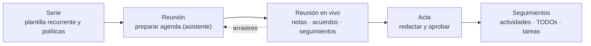

# Community Meetings — Guía de uso y administración

Bienvenido a la suite **Community Meetings** para Odoo 18. Esta guía enseña a
**usar** y **administrar** los módulos — no cubre la instalación.

### En esta página

## Qué obtienes

| Módulo | Qué hace | Para quién |
|---|---|---|
| **Community Meetings** (`community_meetings`) | Reuniones operativas con agendas estructuradas, puntos reutilizables, acuerdos, seguimientos, discrepancias, actas y revisiones aprobadas inmutables. | Todo el mundo |
| **Community Meetings – Project Tasks** (`community_meetings_project`) | Vincula los seguimientos con tareas de **Project** y añade políticas de tareas. | Equipos que usan Project |
| **Community Meetings – Calendar** (`community_meetings_calendar`) | Publica cada reunión programada como evento de **Calendario** de Odoo, de solo lectura. | Todos los usuarios del calendario |
| **Extension Contract Demo** (`community_meetings_extension_demo`) | Ejemplo sintético de cómo ampliar los tipos de reunión. Solo para desarrolladores. | Desarrolladores |

## Quién es quién

La suite funciona por roles. Encuentra el tuyo y sigue su itinerario:

| Rol | Persona típica | Empieza aquí |
|---|---|---|
| **Lector** | Cualquier asistente que consulta reuniones y actas | [Leer una reunión](user/prepare-meeting.md#leer-una-reunión) |
| **Proponente** | Cualquier usuario interno que sugiere puntos | [Proponer un punto](user/propose-a-point.md) |
| **Editor** | Quien prepara y dirige las reuniones | [Preparar una reunión](user/prepare-meeting.md) |
| **Aprobador** | Quien valida las actas | [Actas y aprobación](user/minutes-and-approval.md) |
| **Gestor** | Administrador del módulo | [Administración](admin/configuration.md) |

Los roles son acumulativos: un Editor es también Lector; un Gestor es
Editor + Aprobador. Ver [Roles y permisos](roles-and-permissions.md).

## El modelo mental en 5 minutos

1. Una **serie** describe una reunión recurrente (tipo, personas, calendario,
   políticas).
2. Cada **reunión** concreta se prepara desde la serie o de forma independiente,
   con un **orden del día** de **puntos**.
3. Un **punto** es un asunto con identidad propia: puede tratarse en varias
   reuniones, conservando en cada una su **discusión** y su **resultado**.
4. La reunión se **celebra en vivo** desde una pantalla dedicada: notas,
   acuerdos, discrepancias, seguimientos y aplazamientos se registran al momento.
5. Al terminar se redacta el **acta** y un **aprobador** la congela en una
   **revisión** inmutable con su PDF.

## Mapa de la documentación

| Quiero… | Leer |
|---|---|
| Entender el vocabulario | [Conceptos](concepts.md) |
| Saber quién puede hacer qué | [Roles y permisos](roles-and-permissions.md) |
| Configurar los módulos | [Configuración general](admin/configuration.md) · [Series](admin/series.md) · [Catálogos](admin/catalogs.md) |
| Preparar una reunión | [Preparar una reunión](user/prepare-meeting.md) |
| Sugerir un punto | [Proponer un punto](user/propose-a-point.md) |
| Dirigir la reunión en vivo | [Reunión en vivo](user/live-meeting.md) |
| Redactar, aprobar o corregir actas | [Actas y aprobación](user/minutes-and-approval.md) |
| Registrar quién hace qué | [Seguimientos](user/followups.md) |
| Mover puntos a otra reunión | [Arrastres](user/carryovers.md) |
| Usar Calendario / Project | [Calendario](integrations/calendar.md) · [Project](integrations/project.md) |
| Consultar los cambios entre versiones | [Notas de versión](release-notes.md) |
| Resolver un problema | [FAQ](faq.md) |
