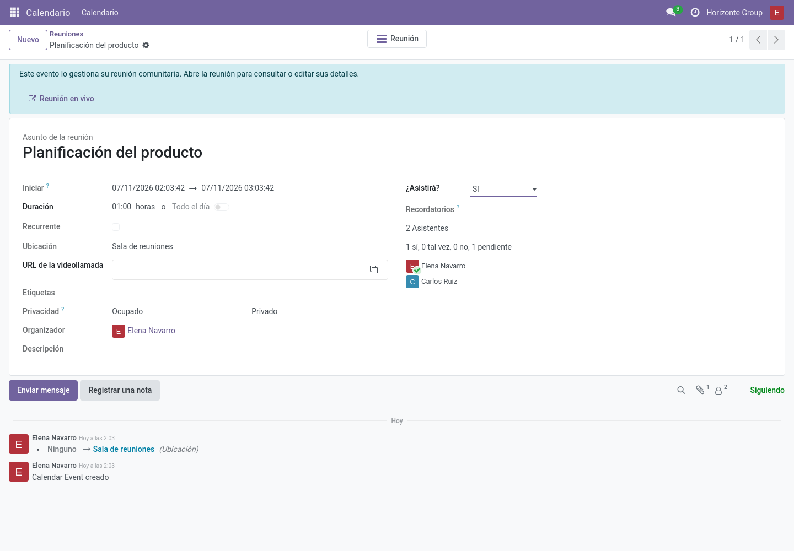
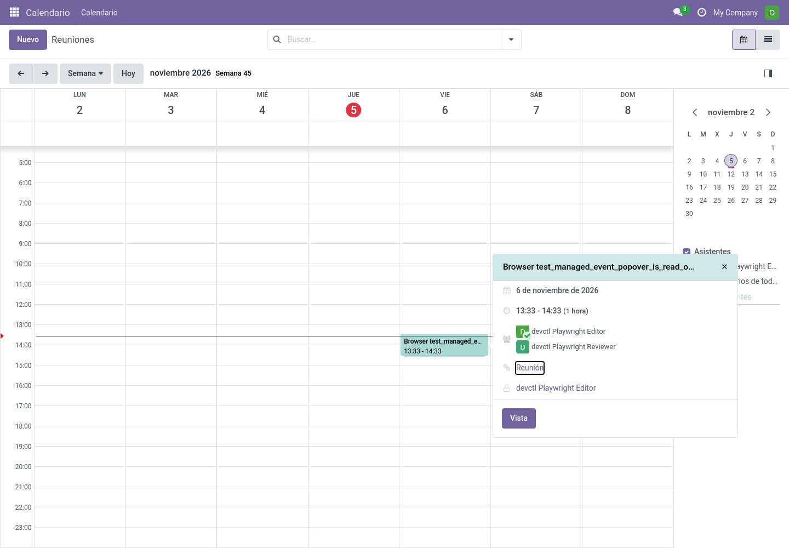

# Integración con Calendario (`community_meetings_calendar`)

Módulo opcional que refleja las reuniones programadas en el **Calendario** estándar
de Odoo para que todo el mundo las vea junto al resto de sus eventos.

## Qué hace

- **Programar** una reunión crea/actualiza un `calendar.event` vinculado con las
  mismas fechas, asistentes, lugar y enlace de videollamada.
- Los cambios de fecha, lugar y asistentes de la reunión actualizan el evento.
- Cancelar la reunión elimina su evento de Calendario vinculado.

## Qué puede hacer el usuario

- Ver la reunión en su calendario (vistas día/semana/mes) y en los recordatorios.
- Abrir la reunión desde el evento: el evento muestra un aviso informativo — *"This
  event is managed by its community meeting"* — y todos los campos gestionados por
  la reunión quedan en solo lectura.

Pulsa un evento de reunión en la cuadrícula para consultar sus detalles en solo
lectura. Elige **Ver** para abrir el formulario del evento y **Abrir reunión**
para volver a la reunión. Las migas de pan de Odoo permiten regresar por el evento
y la reunión cuando ya están en el historial de navegación. Estos eventos gestionados
no muestran botones de respuesta a la invitación; los eventos normales del Calendario conservan sus
controles habituales.

## Qué no puede hacer

Todos los campos gestionados por la reunión son **de solo lectura en el evento**:
nombre, fechas, duración, recurrencia, asistentes, alarmas, privacidad, descripción,
categorías y los botones de envío/invitaciones están deshabilitados.

> **Nota:** para cambiar una reunión usa siempre la reunión (pantalla en vivo o
> formulario), nunca el evento de calendario. El evento es una proyección, no la
> fuente.

## Preguntas frecuentes

**¿Por qué no puedo invitar a más gente desde el evento?** Los asistentes se
gestionan en la reunión (cabecera → *Editar asistentes*), que mantiene la reunión como
única fuente de verdad.

**¿Sigo recibiendo recordatorios de Odoo?** Sí — el evento es un evento real de
calendario con alarmas y notificaciones normales.
