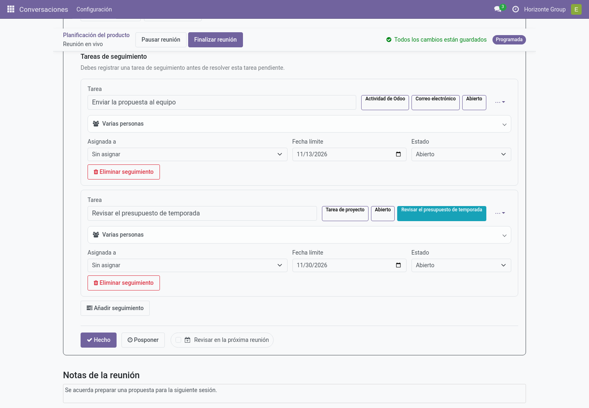
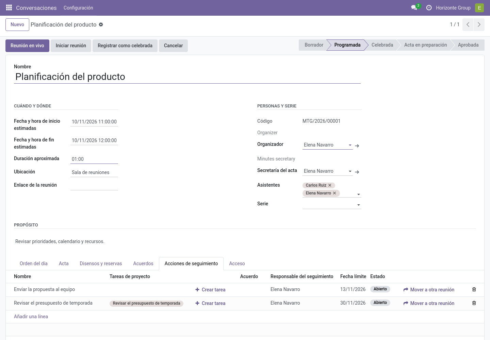
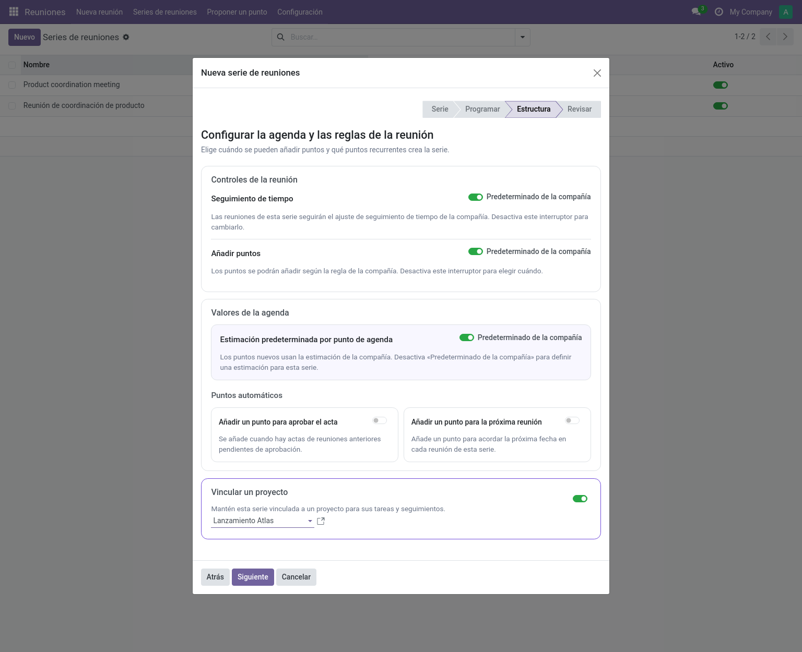
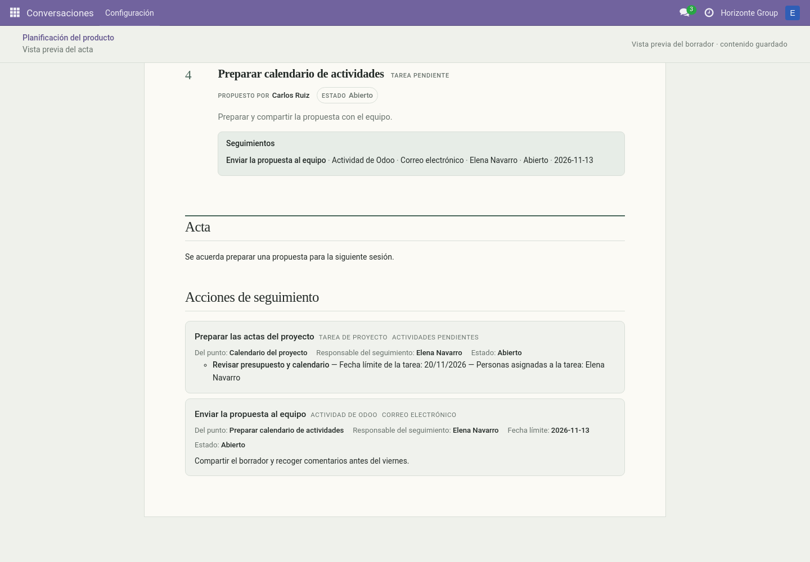

# Integración con Project (`community_meetings_project`)

Módulo opcional que conecta los seguimientos de las reuniones con las tareas de
**Project** de Odoo. Requiere `project` y `community_meetings`.

En la agenda en vivo, el nombre de la tarea vinculada aparece en su
seguimiento. Para crear o vincular una tarea desde la reunión en vivo, pulsa
**Crear tarea de proyecto**; en el formulario de la reunión, el botón se llama
**Crear tarea**.

## Vincular un proyecto al crear una serie

Si está instalado el módulo Project, el paso **Estructura** del asistente de
**Nueva serie de reuniones** incluye el interruptor **Vincular un proyecto**.
Actívalo para elegir un proyecto existente o crear uno para la serie. La elección
se repasa antes de crear la serie y quedará vinculada para sus tareas y
seguimientos. El interruptor empieza desactivado; si lo dejas así, la serie no
queda vinculada a ningún proyecto.

## Crear una tarea desde un seguimiento

En la tarjeta de una reunión en vivo, pulsa **Crear tarea de proyecto**; en la
pestaña del formulario de reunión o en el propio seguimiento, pulsa **Crear tarea**:

1. Elige **vincular una tarea existente** o **crear una nueva**.
2. Para una nueva: elige el proyecto (pre-rellenado según la política, ver abajo) y
   el nombre.
3. **Crear y vincular** — la tarea aparece como etiqueta en el seguimiento y en
   la tarjeta de agenda de la reunión en vivo.

Requisitos: permisos de creación de tareas de Project; la tarea debe pertenecer a un
proyecto de compañía compatible. Una tarea existente se vincula, nunca se duplica.

## Política de tareas

Dos niveles configuran cómo tratan los puntos TODO las tareas — ajustes de compañía
(*Ajustes → Reuniones → Política de tareas de Project*) y la página **Follow-up and Task
Policy** de la serie:

| Ajuste | Opciones |
|---|---|
| **Proyecto de las tareas** | Sin proyecto por defecto · un proyecto de compañía · un proyecto por serie (se crea al primer uso). |
| **Evidencia para resolver un TODO** | Solo seguimiento básico · seguimiento **o** tarea vinculada · tarea obligatoria. |
| **Ámbito de selección de tareas** | Cualquier proyecto accesible · solo el proyecto configurado. |

> **Nota:** por defecto, instalar el módulo no cambia nada: los seguimientos
> asignados del núcleo siguen siendo evidencia suficiente para los TODOs.

## Reglas que protegen la historia

- El nombre, la fecha límite (si está definida) y las personas asignadas de cada
  tarea vinculada legible aparecen por separado de las personas responsables del
  seguimiento. Las nuevas actas aprobadas capturan esos datos en su instantánea;
  los cambios posteriores en la tarea nunca reescriben actas históricas. Las
  revisiones ya aprobadas mantienen su instantánea original y no incorporan
  detalles de tareas retroactivamente.
- El cierre registra la política vigente en ese momento; los cambios posteriores de
  política afectan solo a resoluciones futuras.
- Mientras un TODO resuelto dependa de una tarea, eliminar la tarea o sacarla del
  ámbito queda rechazado.

La vista previa y el acta aprobada muestran cada tarea bajo su seguimiento y
separan las personas asignadas a la tarea de las responsables del seguimiento:

## Encontrar los vínculos desde una tarea

Una tarea de Project muestra el botón **Meeting Agenda Links** que lista los puntos
de agenda, acuerdos y seguimientos vinculados a ella — filtrados por el acceso del
usuario actual.

## Arrastres con tareas

El asistente de arrastres permite a los editores seleccionar explícitamente las
tareas de proyecto vinculadas para continuarlas en la reunión de destino — ver
[Arrastres](../user/carryovers.md).
