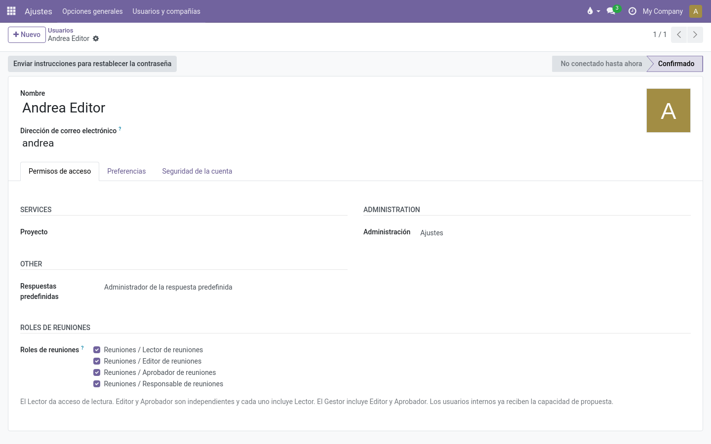

# Roles y permisos

Community Meetings funciona por roles. Los roles se asignan por usuario (lo hace
un administrador del sistema, en el formulario del usuario → *Derechos de
acceso* → **Meeting roles**) y son acumulativos.

## Los roles

| Rol | Qué puede hacer |
|---|---|
| **Proponente** | Sugerir puntos nuevos para una serie (vía *Proponer un punto*). Todo usuario interno lo tiene por defecto. |
| **Lector** | Ver las reuniones de las que es organizador, secretario o lector asignado: agenda, discusión, acuerdos, actas y PDFs aprobados. |
| **Editor** | Todo lo del Lector, más: preparar reuniones, añadir/reordenar puntos, dirigir la reunión en vivo, registrar acuerdos/discrepancias/seguimientos, posponer puntos, gestionar notas editoriales, redactar actas, solicitar arrastres, gestionar series. |
| **Aprobador** | Todo lo del Lector, más: aprobar actas. Independiente del Editor. |
| **Gestor** | Editor + Aprobador, más: iniciar enmiendas sobre reuniones aprobadas, asignar lectores/editores por reunión, cambiar el organizador, toda la configuración (catálogos, ajustes). |

> **Nota:** Editor y Aprobador son independientes: un aprobador que no es editor
> puede aprobar actas pero no modificar la agenda. Un gestor incluye ambos.

## Quién ve una reunión

Una reunión es visible para:

- su **organizador** (coordinación),
- su **secretaria o secretario de actas**,
- los **lectores** y **editores** asignados expresamente en la pestaña *Acceso*
  de la reunión,
- cualquier **gestor** de la compañía.

Estar listado como *asistente* (contacto) **no** da acceso — los asistentes son
contactos, no necesariamente usuarios. Concede el acceso por usuario en la
pestaña **Acceso**.

## Contenido restringido

Dos tipos de registros están especialmente protegidos:

- **Notas editoriales** — solo visibles para los editores de la reunión. Nunca
  se muestran a los lectores y **nunca** entran en las actas aprobadas.
- **Discrepancias** — las gestionan los editores; los lectores solo ven las
  marcadas con *incluir en el acta*.

## ¿Quién puede añadir puntos a una reunión?

Se configura por compañía y por serie (ver
[Añadir puntos](admin/configuration.md#añadir-puntos)). Según la política, dejar
de poder añadirse al salir de borrador, al iniciarse o al terminar. El botón
**Añadir punto** simplemente desaparece cuando no está permitido — y el servidor
también lo impide.

## Propuestas

Cualquier usuario interno puede proponer puntos, salvo que el gestor restrinja
la propuesta a grupos concretos (ver
[Grupos de proponentes autorizados](admin/catalogs.md#grupos-de-proponentes-autorizados)).

## Tabla rápida

| Acción | Lector | Editor | Aprobador | Gestor |
|---|:-:|:-:|:-:|:-:|
| Ver reuniones y actas asignadas | ✔ | ✔ | ✔ | ✔ |
| Descargar el PDF aprobado | ✔ | ✔ | ✔ | ✔ |
| Proponer un punto | ✔¹ | ✔ | ✔ | ✔ |
| Añadir puntos a una agenda | | ✔ | | ✔ |
| Dirigir la reunión en vivo | | ✔ | | ✔ |
| Registrar discrepancias / notas editoriales | | ✔ | | ✔ |
| Redactar el acta | | ✔ | | ✔ |
| Aprobar el acta | | | ✔ | ✔ |
| Iniciar una modificación | | | | ✔ |
| Asignar lectores/editores por reunión | | ✔² | | ✔ |
| Configurar series, tipos, ajustes | | | | ✔ |

¹ O restringido a grupos concretos por configuración.

² Los editores solo en reuniones que organizan; los gestores en cualquiera.
