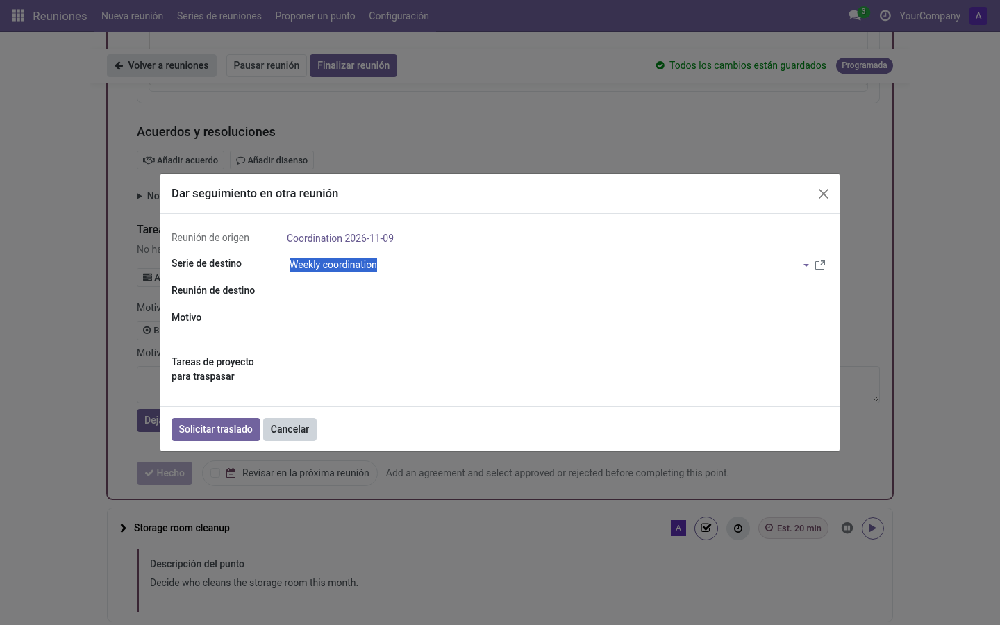

# Arrastres: mover puntos entre reuniones (editor)

Un **arrastre** continúa el tratamiento de un punto (o revisa un seguimiento, o
mueve un acuerdo) en una reunión posterior.

## Las tres vías para mover un punto

1. **Política de serie — Revisión** *(por defecto)*: al terminar una reunión, sus
   puntos sin terminar se ofrecen a la siguiente reunión de la serie. Los editores
   aceptan/descartan al crearla y en la pantalla en vivo (*Puntos que continúan*).
2. **Política de serie — Automática**: lo mismo, sin preguntar.
3. **Manual**: desde cualquier punto, **Posponer → Mover a otra reunión** abre el
   asistente de arrastre, sea cual sea la política.

## El asistente de arrastre

- **Serie de destino** (obligatoria para acuerdos/actas) o **reunión de destino**
  (para puntos y seguimientos).
- **Motivo** — texto libre; pre-rellenado con el motivo del aplazamiento si existe.
- Con el módulo Project: se pueden arrastrar explícitamente las **tareas de
  proyecto** vinculadas (selección del editor).

Los editores de la reunión de destino las reciben como *Puntos que continúan*
(política Revisión) o las encuentran ya en la agenda (política Automática). El
registro muestra la reunión de origen, el contexto y quién respondió.

## Moverlo a otra serie

Un punto puede quedarse fuera del alcance de su serie (p. ej. un punto operativo
que necesita un debate de reflexión). El asistente de arrastre acepta una **serie
de destino**:

- **Puntos y seguimientos** — elige la serie de destino y, opcionalmente, una
  reunión concreta de esa serie; si dejas la reunión vacía, el punto se ofrece en
  la próxima reunión de esa serie.
- **Acuerdos (actas)** — la serie de destino es obligatoria (se tratan a nivel de
  serie).

La serie de destino puede ser cualquier serie activa de la misma compañía, así
que esta es la vía para mover un punto fuera de su ámbito original.

## Aceptar / descartar

- **Aceptar** — el punto entra en la agenda de destino como una nueva participación
  del mismo punto (la identidad se conserva).
- **Descartar** — se rechaza la oferta; con política *Revisión* puede ofrecerse de
  nuevo más adelante, y *Descartar* en el asistente de creación la descarta para
  siempre.

El punto continuado puede mostrar sus **notas de debate anteriores** como
contexto de solo lectura, con la reunión de origen identificada. Las notas se
conservan en la participación original y no se copian al acta nueva. Un editor
puede elegir **Empezar sin notas anteriores** para dejar de mostrar el debate
previo en esta continuación y en las siguientes; las notas originales se
conservan. Este control no se aplica a los puntos *Aprobación del acta* ni
*Próxima reunión*.

## Documentación relacionada

- [Política de arrastre de la serie](../admin/series.md#políticas)
- [Asistente de creación, puntos que continúan](prepare-meeting.md#el-asistente-guiado)
- [Tareas de Project en los arrastres](../integrations/project.md)
