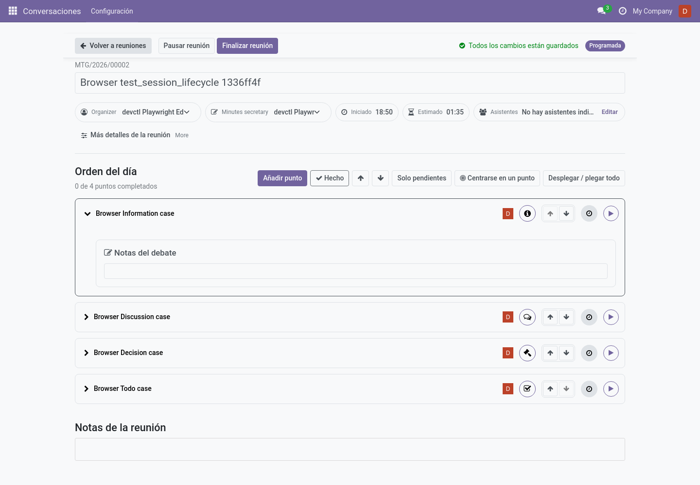
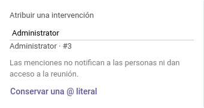

# La reunión en vivo (editor)

La pantalla **reunión en vivo** es un espacio de trabajo a página completa pensado
para proyectarse durante la reunión mientras se toman notas a la vez. Ábrela desde
cualquier reunión programada/celebrada: el botón ▶ en la lista o **Open Live
Meeting** en el formulario.

## Barra superior

- **Volver a reuniones** — salida segura (avisa de ediciones pendientes).
- **Botones de flujo** — dependen del estado y la política:
  - *Iniciar reunión / Pausar / Reanudar* — solo con seguimiento de tiempo **on**.
  - *Finalizar reunión* — cierra la reunión (con tiempo de tiempo desactivado está
    disponible directamente sobre una reunión programada; un diálogo de confirmación
    protege la vía retroactiva *Registrar como celebrada*).
  - *Preparar el acta* — una vez celebrada.
  - *Aprobar el acta* — aprobadores, con el acta en borrador.
- **Estado de guardado** — *Guardando… / Todos los cambios están guardados / Cambios pendientes*: todo se
  guarda automáticamente mientras escribes; el indicador dice cuándo puedes salir.
- **Insignia de estado** — estado actual de la reunión (Programada / En curso / …).

## Cabecera

Nombre (editable en línea), inicio/fin/duración previstos frente a **reales**
(solo con seguimiento de tiempo activado), coordinación y secretaría (editables en
línea), lugar, enlace de la reunión y asistentes — con un diálogo de búsqueda
*Editar asistentes*.

## Puntos que continúan

Si esta reunión hereda puntos arrastrados (política *Revisión*), un aviso los lista
con **Aceptar** / **Descartar** antes de la agenda.

## Tarjetas de agenda

Cada punto es una tarjeta: título, avatar del ponente, bandera de prioridad, insignia
de tipo, **insignia de resultado** y — con seguimiento de tiempo — sus controles de
cronómetro (*Iniciar/Pausar punto*, *Punto en curso / en pausa*).

Herramientas sobre la lista: **Añadir punto** (según la
[política de añadir puntos](../admin/configuration.md#añadir-puntos)), flechas
anterior/siguiente, filtro **Solo pendientes**, **Expandir/Contraer todo**.

Cuando la política de reordenamiento de la compañía o de la serie lo permite,
también se pueden subir o bajar puntos normales. Durante la reunión, pulsa
**Reordenar agenda** sobre las tarjetas para mostrar las flechas; al terminar,
pulsa **Hecho**. Los puntos de aprobación del acta, de próxima reunión y los
marcados como fijos conservan su posición. El orden se bloquea al marcar la
reunión como **Celebrada**.

### Dirigir un punto

1. **Iniciar punto** (con tiempo activado) — habilita la edición y arranca su
   cronómetro; iniciar un punto nuevo pausa el anterior automáticamente.
2. **Notas de discusión** — texto enriquecido, autoguardado. Con cronómetros, solo
   se editan con el cronómetro del punto en marcha (o tras la reunión, redactando el
   acta). Sin cronómetros, siempre editables hasta que la reunión termine.
   Cuando haya notas de reuniones anteriores, aparecen encima como contexto de
   solo lectura y nunca se añaden al acta actual. Los editores pueden empezar sin
   ese contexto; las notas originales permanecen en sus reuniones.
3. **Registrar resultados**:
   - *Información* — marca **Hecho**.
   - *Discusión* — **Hecho** al resolverse, o **Posponer**.
   - *Decisión* — registra un **Acuerdo** con resultado *aprobado/rechazado*; el
     punto solo se completa con acuerdo. Los acuerdos pueden retirarse.
   - *TODO* — añade un **seguimiento** asignado; el punto no puede resolverse sin él
     (ver [Seguimientos](followups.md)).
4. **Hecho** completa el punto; **Deshacer resultado** lo reabre (motivo opcional).
5. **Posponer** — elige un motivo rápido (bloqueado por punto/tarea/actividad, falta
   de tiempo, otro…), un enlace opcional de "bloqueado por", y *Dejar pospuesto* o
   *Mover a otra reunión* (asistente de arrastre). Los puntos pospuestos quedan
   marcados **Revisar en la próxima reunión** automáticamente.

### Atribuir una intervención con @

En las **Notas de discusión** editables, escribe `@` tras un espacio o al
principio de una línea. Se abre un buscador de contactos. Escribe un nombre y
elige con el ratón o con las flechas y **Intro**; **Escape** o **Conservar una @
literal** vuelve a las notas sin sustituir el carácter.

Primero aparecen los contactos invitados y después otras personas activas que
puedes leer, de la compañía de la reunión o compartidas. Los usuarios aparecen
una sola vez mediante su contacto. El número de contacto permite distinguir
homónimos; el selector no muestra correos ni teléfonos.
Usa **Más contactos…** para cargar la siguiente página si hay más de 20 resultados.

El nombre atribuye la intervención según lo registrado por quien toma notas;
no autentica quién habló. No envía notificaciones, suscripciones ni invitaciones
y no concede acceso a la reunión. La etiqueta no abre la ficha del contacto.
Los nombres se conservan tal como se registraron aunque se renombre, archive o
elimine el contacto. El debate anterior, la vista previa y las revisiones
aprobadas conservan el nombre visible. El formulario clásico conserva la
etiqueta como HTML legible; su editor no ofrece el selector @. Se mantienen las
restricciones de pausa, punto activo y aprobación.

### Registros dentro de un punto

- **Acuerdos** — las decisiones (título, cuerpo, resultado). Retirar un acuerdo
  devuelve la decisión a pendiente.
- **Discrepancias** — persona, catálogo de motivos y declaración. Todas las
  discrepancias registradas aparecen en el acta.
- **Notas editoriales privadas** — bloc solo para editores, nunca en el acta.
- **Tareas de seguimiento** — responsables, plazos, estado, conversión entre tipos,
  *varias personas responsables* en opciones avanzadas.
- **Puntos relacionados / Origen / Desde un seguimiento** — enlaces para saltar
  entre puntos.

### Puntos especiales

- **Próxima reunión** — campo de fecha y hora (zona horaria de la serie visible) para
  fijar la siguiente fecha.
- **Aprobación del acta** — lista las actas pendientes con atajo *Revisar* y el
  historial de las ya aprobadas.

### Opciones del punto

*Opciones del punto → Editar detalles del punto* abre el registro completo del punto;
**Reabrir** con motivo reabre un punto completado.

## Después de la reunión

**Finalizar reunión** cierra los tiempos reales, pausa los cronómetros abiertos, marca
los puntos sin terminar para revisión y promueve los seguimientos finalizados a
puntos de la próxima reunión. Después toca redactar el acta →
[Actas y aprobación](minutes-and-approval.md).

Cuando una reunión ya ha empezado, **Cancelar** deja de estar disponible: usa
**Finalizar reunión** para cerrar los cronómetros y conservar el historial real.
