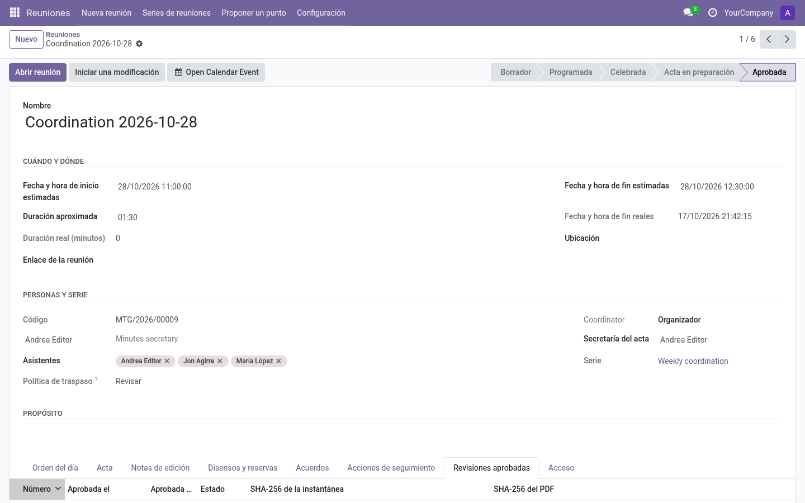

# Actas y aprobación

El acta se construye desde el trabajo de la reunión en vivo y se formaliza en dos
pasos: **preparar → aprobar**.

## 1. Preparar el acta

Con la reunión **Celebrada**, pulsa *Preparar el acta* (pantalla en vivo) o en el
formulario. La reunión pasa a **Acta en borrador**:

- La sección **Notas de la reunión** (parte baja de la pantalla en vivo, o pestaña
  *Acta* del formulario) se convierte en el foco. Es texto enriquecido con
  autoguardado.
- Las notas de discusión de cada punto permanecen en su punto; la sección de notas
  es donde vive el relato del acta.
- Aún puedes añadir contenido, ajustar acuerdos/discrepancias y
  corregir seguimientos (la [política de añadir
  puntos](../admin/configuration.md#añadir-puntos) limita los puntos de agenda
  nuevos).
- Las **notas editoriales privadas** quedan fuera del acta — úsalas para comentarios
  internos y bórralas antes de aprobar si conviene.

Antes de aprobar, usa **Vista previa del acta** en el formulario o en la pantalla
en vivo para revisar el borrador completo, compuesto con los datos guardados de
la reunión. La vista indica que aún no está aprobado y señala las secciones de
origen para volver a ellas y editar. Guarda primero los cambios pendientes de la
pantalla en vivo. Usa **Notas de la reunión** para el relato general; la
discusión de los puntos, los acuerdos, los seguimientos y las discrepancias
incluidas proceden de sus propios registros. El PDF oficial se crea cuando el
aprobador aprueba el acta.

La vista previa muestra la hora de la reunión en tu zona horaria de usuario.
El acta aprobada usa la zona de la serie; si la reunión es independiente, usa
la de la compañía y, si tampoco está configurada, UTC. La zona aparece junto a
la hora.

En estado **Celebrada** o **Acta en borrador**, la vista previa es de solo
lectura: abrirla y volver a la reunión no cambia el contenido guardado ni su
estado. Cualquier persona con acceso de lectura a la reunión puede abrirla;
consulta [Roles y permisos](../roles-and-permissions.md) para ver cómo se
concede ese acceso.

> **Consejo:** el punto de aprobación del acta de las reuniones *posteriores*
> listará este acta hasta aprobarla — apruébala pronto para no ensuciar la cola.

## 2. Aprobar

En las series que exigen el punto de aprobación del acta, cada acta anterior
pendiente tiene su propia acción **Aprobar actas anteriores** en ese punto.
Pulsa **Revisar** junto a una reunión anterior para abrir su borrador guardado
en la vista previa de solo lectura; **Volver a la reunión en vivo** vuelve al
mismo punto. Revisar no pausa ni termina un punto en marcha. En la preparación
offline, el punto se cierra cuando se han aprobado todas las actas anteriores.
La aprobación directa en la reunión anterior queda bloqueada. El historial
guarda la revisión exacta; si se enmienda y se vuelve a aprobar, la nueva
revisión queda registrada aparte.

En una serie que no usa un punto de aprobación posterior, pulsa **Aprobar el
acta** (pantalla en vivo o cabecera del formulario). Si la serie usa ese punto,
el acta actual queda pendiente para que se apruebe desde el punto de una reunión
posterior; la acción directa queda bloqueada. Consulta [Roles y permisos](../roles-and-permissions.md)
para saber quién puede seguir cada ruta de aprobación.

La aprobación:

- congela la reunión en estado **Aprobada**;
- crea una **revisión** inmutable con instantánea del contenido (SHA-256) y su
  **PDF**;
- marca el acta como aprobada en los *puntos de aprobación del acta* de las
  reuniones posteriores de la serie;
- deja la reunión en solo lectura para todos.

## Revisiones aprobadas y enmiendas

La pestaña **Revisiones aprobadas** lista cada revisión: número, fecha de aprobación,
aprobador, estado y botón **PDF**.

Tras la aprobación, cambiar el contenido está bloqueado a propósito. Si hay que
corregir algo, un gestor de reuniones pulsa **Iniciar una modificación**: la reunión reabre para
edición bajo una nueva revisión; la revisión anterior y su PDF permanecen intactos
en la historia.

## Discrepancias y acta

Todas las discrepancias registradas forman parte del acta aprobada. Las notas
editoriales privadas son independientes y nunca se incluyen. Repasa las
discrepancias registradas con la persona editora antes de aprobar.

## Preguntas frecuentes

**¿Quién firma?** Quien aprueba (queda registrado en la revisión).

**¿Se re-aprueba tras una enmienda?** Sí — la enmienda se aprueba igual que el
original y produce la revisión N+1.

**¿Un lector ve el acta enmendada?** Los lectores siempre ven el último contenido
aprobado y pueden descargar el PDF de cada revisión de la reunión si tenían acceso.
