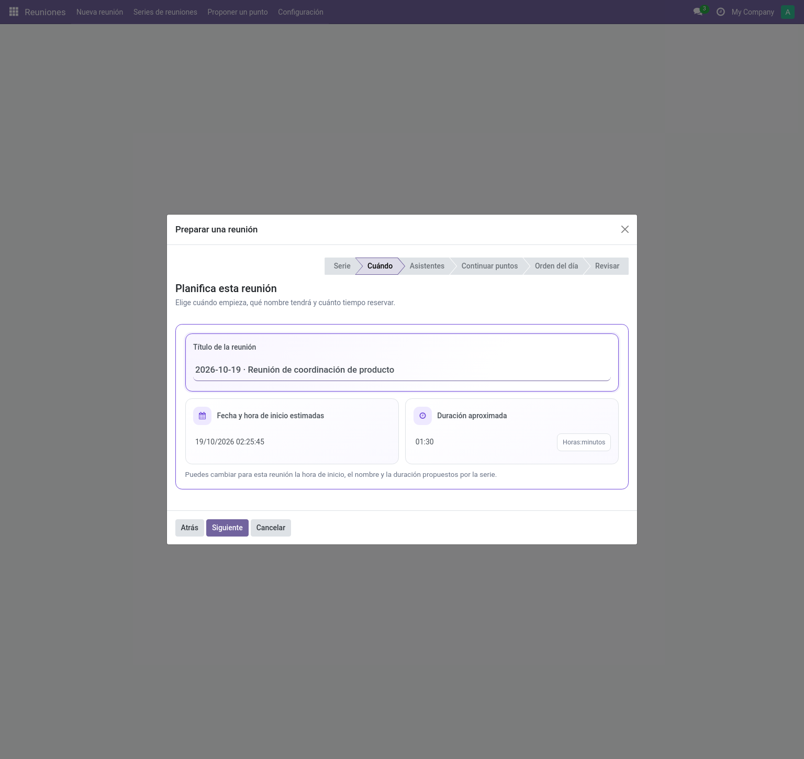
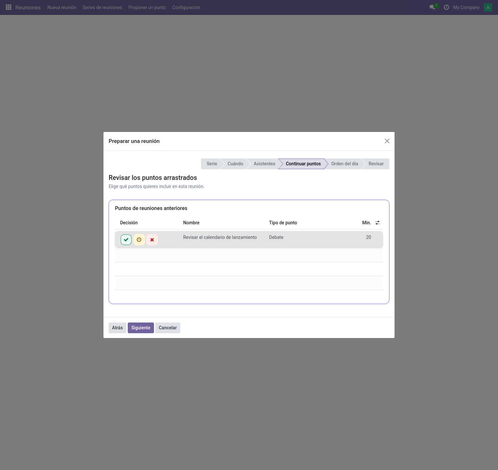
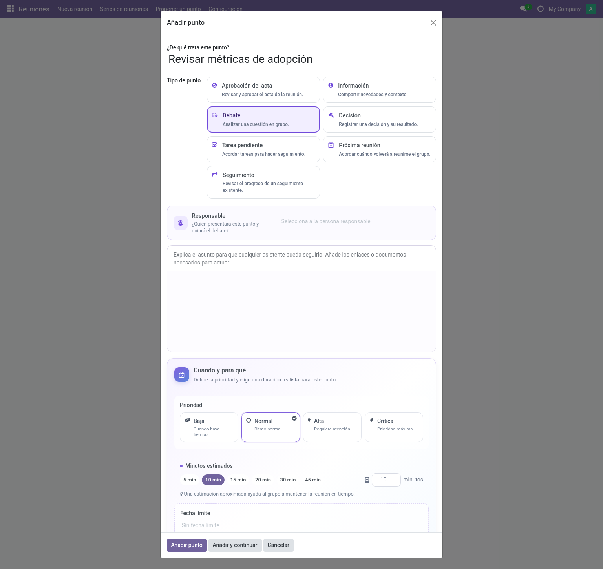

# Preparar una reunión (editor)

Dos puntos de entrada: el asistente **Nueva reunión** (guiado) o abrir una serie y
pulsar **Nueva reunión** allí (el mismo asistente, con la serie preseleccionada).

## El asistente guiado

El asistente recorre seis pasos; puedes avanzar y retroceder libremente, y tus
cambios se conservan al cambiar de serie. Al elegir una serie, sus valores se
aplican automáticamente; no hay que confirmarlos con otro botón.

1. **Serie** — elige una o déjala vacía para una reunión independiente. Al elegir
   una serie se aplican sus sugerencias; si cambias de serie, se actualizan sin
   perder tus ediciones.
2. **Cuándo** — fecha/hora de inicio, título (pre-rellenado con el patrón
   `{date} {series}`) y duración aproximada. Los iconos señalan el inicio y la
   duración. Esta última se expresa en horas:minutos (`1:00` es una hora); la
   hora de fin se calcula.
3. **Personas** — asistentes (pre-rellenados desde la serie).
4. **Puntos que continúan** — si la política de arrastre es *Revisión*, aparecen
   aquí los puntos de reuniones anteriores y, cuando están disponibles, su
   origen y motivo. Usa el visto verde para **Aceptar** e incluir un punto, el
   reloj ámbar para **Posponerlo** o la cruz roja para **Descartarlo**. Se muestran
   el tipo, la prioridad y los minutos estimados cuando están disponibles. Con
   política *Automática*, los puntos sin terminar ya vienen incluidos.
5. **Agenda** — añade puntos ahora (o después). La estimación de minutos
   seleccionados incluye los puntos que añadas y los que hayas aceptado de
   reuniones anteriores. Todavía no incluye los puntos estructurales que la
   serie pueda añadir automáticamente.
6. **Revisión** — comprueba los datos y la agenda. Los puntos que continúan
   muestran el título y, debajo, la decisión y otros datos, además de su tiempo
   total estimado. El resumen de agenda incluye los puntos automáticos cuando la
   serie los genera; **Crear reunión** termina.

> **Consejo:** el asistente copia los valores de la serie; no los enlaza. Cambiar
> la serie después no reescribe la reunión.

En el paso de arrastres, cada punto anterior tiene iconos de decisión directos.
La revisión final separa los minutos arrastrados de los de la agenda de esta
reunión, incluidos los puntos estructurales que se añaden automáticamente.

## Leer una reunión (itinerario lector)

Los lectores abren las reuniones desde **Meetings → Reuniones** (o el calendario).
Ven la agenda con resultados, notas de discusión, discrepancias publicadas,
acuerdos, seguimientos y — una vez aprobada — el acta con botón de **PDF** en la
pestaña *Revisiones aprobadas*. Todo en solo lectura.

## Añadir puntos

En el formulario de la reunión, **Añadir punto** abre un diálogo centrado:

- **Título** — una línea clara: es lo que leerán los asistentes.
- **Tipo de punto** — las tarjetas explican el comportamiento de cada tipo. El
  tipo elegido se compacta; vuelve a pulsarlo para mostrar las opciones y sus
  explicaciones (ver [catálogos](../admin/catalogs.md#tipos-de-punto-de-agenda)).
- **Descripción** — texto enriquecido: contexto, enlaces, documentos.
- **Responsable** — elige cerca de la parte superior quién presentará el punto.
  Debajo de la planificación puedes relacionar otros puntos.
- **Más opciones** — pulsa cualquier parte de la fila para reutilizar un punto o
  ajustar las reglas de seguimiento. Al reutilizarlo se conservan el título, la
  descripción y el tipo; aquí puedes cambiar quién es responsable. **Quitar el
  punto seleccionado** permite volver a crear uno nuevo.

La **planificación** permite elegir prioridad, plazo y minutos estimados. Estos
últimos vienen pre-rellenados con el valor de la serie o, si usa el valor
predeterminado, con el de la compañía. **Añadir y continuar** encadena varios
puntos rápido.

> **Nota:** la disponibilidad de *Añadir punto* depende del estado de la reunión y de
> la **política de añadir puntos** de su serie — desaparece al vencer el plazo y el
> servidor también lo impide.

En el formulario de la reunión aparece un aviso cuando la suma de estimaciones
de la agenda supera la duración prevista. Ajusta allí la duración o los puntos.

## Programación y cambios de serie

- **Programar** confirma la reunión (exige fecha de inicio) y publica el evento de
  calendario.
- La serie puede cambiarse mientras la reunión esté *en borrador o programada* y no
  haya comenzado la ejecución en vivo. Los puntos compartidos con otras reuniones
  limitan el cambio.
- **Cancelar** está disponible en borrador/programada.

## Pestaña Acceso

Los editores pueden conceder acceso de **lector**/**editor** en las reuniones que
organizan; los gestores también pueden cambiar organizador, secretaría y acceso de
cualquier reunión.

Siguiente: celebrarla → [Reunión en vivo](live-meeting.md).
